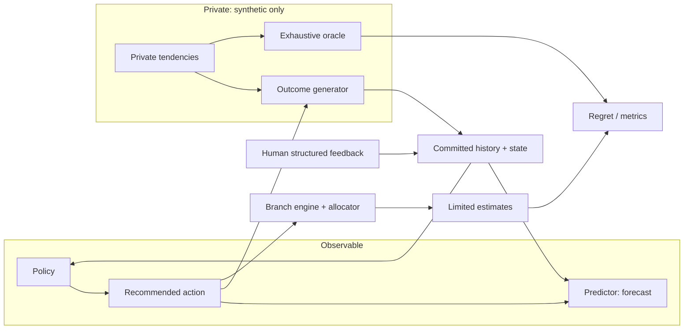

# Scientific interpretation reference

A reader's companion for the numbers this application shows. It summarises the backend's documented behaviour from
`docs/reference/MASTER_SYSTEM_REPORT.md` (MSR) and `docs/reference/API_CONTRACT.md`, plus wire shapes observed from the
real offline backend (`docs/OBSERVED_CONTRACT_NOTES.md`).

**The frontend computes none of these values.** It renders what the backend returns. Formulas are reproduced here only
to explain meaning. Section references (§) point to the MSR.

---

## 1. Authority: who produces what

The diagram enforces five rules:
- There is **no arrow from the forecast to the outcome**.
- Private synthetic tendencies reach only the outcome generator and the oracle, never a policy, predictor or allocator
  (§4, §20).
- Branch results are hypothetical and are never committed to the session (§13).
- Only the backend application layer commits state.
- The frontend only renders.

---

## 2. Reactions, forecasts and conformal sets

- **Reactions.** Four classes in fixed order: ACCEPT, MODIFY_CLARIFY, DEFER, REJECT (§9). Every probability vector uses
  this order.
- **Forecast** (`pending.probabilities`). The predictor's estimate from observable, pre-reaction information only. It
  is persisted before feedback, and the same vector later appears unchanged in `evidence[i].forecast`.
- **Predictor modes** (§11):
  - *population*: frozen multinomial logistic regression, `p = softmax(xW + b)`;
  - *class_bias*: population probabilities adjusted toward the scenario's revealed class counts, with prior
    concentration 100 (structured bundle);
  - *contextual*: an online softmax correction on selected observable features, updated after each reveal (learning
    rate 0.01, L2 0.1 for structured).
- **Ownership.** Adaptive state is owned by one profile and scenario and cannot be reused elsewhere.
- **Population vector** (`conformal_reference.population_probabilities`). Returned alongside every forecast. For the
  population predictor it equals the forecast exactly (verified). For adaptive predictors it shows what the frozen
  model alone would say.
- **Conformal sets** (`conformal_reference.sets`, §12). For methods APS, APS_V1, RAPS and SAPS at nominal coverage 0.8,
  0.9 and 0.95, each set lists the labels judged plausible under a **frozen synthetic calibration**.
  - Sets are always computed from the **population** probabilities.
  - They can be empty.
  - They give **no coverage guarantee for human feedback**.
  - They never prune branches.

**Reading tip.** Disagreement between a forecast and the realized reaction is expected. This application makes no
accuracy claim, and one turn is not evidence about predictor quality.

---

## 3. Outcomes

| World | Who decides the reaction | Provenance shown |
|---|---|---|
| Human | You, as a structured submission | `human_interaction · human_submission · factual` |
| Synthetic | An independent simulator | `synthetic_simulation · synthetic_generated · factual` |

**Structured simulator** (§9). Reaction logits combine:
- overall fit (health, taste, effort and budget mismatch, weighted by private priorities);
- constraint conflict, repetition, the last unresolved request and the prior reject rate;
- the six state variables;
- an archetype offset.

Softmax is applied at temperature 0.92, then one reaction is drawn with a seeded random number. Continuation is a
separate seeded draw. Requested changes are generated only for MODIFY_CLARIFY.

**Agenda-derived simulator** (§9). Rule-based:
- a constraint conflict gives REJECT;
- accepted-item repetition with a high novelty preference requests novelty;
- otherwise a private preference score is thresholded.

Its probability vector is one-hot and it has no random draws.

The synthetic outcome's probabilities, draws and reason codes appear on the Session page under **"Simulator internals
(post-hoc audit, not predictor input)"**. They explain how the simulator produced the reaction; the predictor never saw
them.

**Continuation.** A human DISENGAGE closes the session. A synthetic DISENGAGE does not (verified); the full horizon
always runs.

---

## 4. State transition

After each reveal, each of the six state variables moves by a fixed reaction-dependent delta, is clamped to [0, 1] and
rounded to 4 decimals (§10). The delta table is in [USER_GUIDE.md §3](USER_GUIDE.md#the-six-engineered-state-variables).
- Continuation does not change the arithmetic.
- Requested-change instructions are appended to `recent_preferences` (the last 12 are kept).
- Rejection does **not** automatically fill `avoided_recently`.

These variables are engineering constructs. Their names do not make them psychological measurements, even after human
feedback (§10, §29).

---

## 5. Branching, allocation and estimates

**Paired tree** (§13–14). Both policies start from the same factual root (the pending recommendation and its completed
history). Each node pairs, for the two policies, under the same hypothetical reaction path:
- the step and cumulative probabilities;
- the next recommended recipe;
- the utility.

Branch probabilities always come from the **frozen population predictor**. Simplifications of the branch model:
- every branch continuation is CONTINUE;
- hypothetical MODIFY_CLARIFY carries residual text only;
- depth is limited to 2, giving at most 4 + 16 = 20 nodes.

**Display probability.** A node's `calibrated_reaction_probability` is the mean of the two policies' step
probabilities. Each policy's own numbers are in `policy_evidence[i]`.

**Allocators** (§15). They choose the next frontier node to expand, never a recipe.

| API name | Identifier | Primary criterion |
|---|---|---|
| equal | `equal_round_robin` | Fewest expansions in a first-reaction subtree |
| greedy | `greedy_highest_probability` | Highest path probability P |
| uncertainty | `uncertainty_first` | Highest uncertainty U |
| pcub | `pcub_probability_uncertainty_disagreement` | `wP·P + wU·U + wD·D − wC·C` |

- **P** is the mean cumulative path probability.
- **U** is a normalised single-label entropy contribution.
- **D** is ingredient-set distance between the two policies' recipes × a reaction sensitivity.
- **C** is cost (constant 1).
- **Frozen PCUB weights**: structured (0.5, 0.5, 0, 0); agenda (0.7, 0.2, 0.1, 0). The structured weights give
  **disagreement zero weight**, despite the method's name.
- Ties break by depth, then reaction order, then id.

The API does not return per-node P/U/D/C values, so the UI does not show them.

**Budget.** The maximum number of nodes the **evaluation** expands.
- In every tested run, `result.actual_expansions` equalled the budget.
- The backend first runs a full 20-node **preparation** pass to establish decision closure. Preparation and
  evaluation costs are reported separately in `costs`.

**Utility** (§18). For each node and policy:
- `Us = (satisfaction + engagement + trust + motivation + (1 − resistance) + (1 − fatigue)) / 6`
- `Ua = 0.5·health + 0.5·(1 − min(issues/2, 1))`
- `u = 0.7·Us + 0.3·Ua`

It is an engineered objective, not human welfare or clinical benefit.

**Limited estimate** (§16). For each policy and each visited depth d, the backend takes the probability-weighted mean
of utility over the visited nodes, then sums over the visited depths. Consequences:
- Unvisited mass is ignored, not imputed.
- A run that visits only depth 1 has a different scale from a two-depth run.
- Estimates are therefore **not unbiased expectations** and **not comparable across budgets**.

The policy with the larger estimate is `selected_policy`.

---

## 6. The synthetic oracle and metrics

**Oracle** (§17, synthetic sessions only). For each policy:

`V = Σ_r1 p*(r1) · [u(r1) + Σ_r2 p*(r2 | r1) · u(r1, r2)]`

using the simulator's **private** probabilities over all 20 nodes, with no discounting (so values can exceed 1).
- It is independent of the allocator and budget (verified: identical values across budgets and allocators for one
  root).
- Its returned `meaning` text is "synthetic-model reference; never human ground truth".
- A human oracle does not exist.

Metrics (`comparison.metrics`, present only when the oracle ran):

| Field | Meaning |
|---|---|
| `regret` | `max oracle value − oracle value of selected_policy`. 0 = the limited method chose the simulator-preferred policy at this root. |
| `best_policy_correct` | `regret ≤ 1e-12` |
| `oracle_best_policy`, `oracle_margin` | The oracle's preferred policy and its value gap to the other |
| `value_mae`, `value_rmse` | Error of the limited estimates against the oracle values (mean absolute / root mean square) |
| `rank_agreement` | 1 if the estimate and the oracle order the two policies the same way, 0 if not |
| `expanded_first_reaction_count`, `expanded_depth_counts` | How many first-reaction subtrees, and how many nodes per depth, were expanded |
| `branch_policy_recipe_disagreement` | Share of expanded nodes where the two policies recommend different recipes. Not the same as PCUB's D. |
| `estimated_policy_values`, `oracle_policy_values`, `expansion_order` | Verbatim copies (shown under "Other metric fields") |

**One comparison is one case.** It covers one root, one simulator and one seed namespace. Each new synthetic session
gets a new identity, so results generally differ between sessions.

Two engineering captures illustrate this, each from a single run (budget 8, PCUB, root at turn 4):
- **Structured simulator:** regret **0**, limited selection agreed with the oracle.
- **Agenda simulator:** regret ≈ **0.072**, limited selection **disagreed** (rank agreement 0).

Neither run supports a general claim. The aggregate historical evidence is R1 (§8 below).

---

## 7. Costs and provenance

- **Logical counters** (`result.recommender_calls`, `predictor_calls`, `llm_calls`, `llm_tokens`) count internal
  simulation work. They are **not provider calls**. The engine's `llm_*` fields are 0 even when preparation recorded
  provider work.
- **Provider work** is reported in `costs.preparation`, `costs.evaluation` and `costs.combined`, and per recommendation
  in `pending.provider_costs`.
  - Offline, all are 0.
  - Null means unknown, never zero.
  - Recorded or cached reuse is not a fresh charge.
- **Unknown completion.** A provider request that may have completed without a durable record must never be retried
  (§22). This is unreachable offline.
- **Provenance** has four fields: `world_kind`, `reaction_origin`, `evidence_status` and
  `recommendation_execution_mode` (§24). Pending forecasts have origin null; hypothetical branches are
  `counterfactual / hypothetical`; interactive evidence never carries an R1 reference fingerprint.

---

## 8. Historical R1 (frozen; never updated)

These are R1 aggregates as returned by `GET /v1/reference-results/r1`. The design was 4 policies × 2 simulators × 60
test profiles × 12 turns.

| | Structured simulator | Agenda simulator | Reading |
|---|---|---|---|
| RQ1 gain (guarded − feedback, oracle value) | −0.0573 [−0.0710, −0.0438] | −0.1056 [−0.1264, −0.0857] | **No positive guarded gain** |
| RQ2 sibling top-1 change: guarded vs feedback | 41.9% vs 7.5% | 44.7% vs 6.7% | **More history-sensitive; sensitivity ≠ utility** |
| RQ3 mean regret, lowest allocator | uncertainty-first ≈ 0.00056 (PCUB ≈ 0.00145) | PCUB ≈ 0.00378 | **Strict PCUB superiority not established** |
| RQ4 operations | 5,100 reserved = completed, 0 unknown, 1 fallback; replay with 0 network calls | | **Favorable operational and replay evidence** |

`formal_closure_present` is **false**. R1 is not formally closed.

The demo backend's own provider journal contains one unresolved unknown-completion reservation from an earlier live
test (MSR §22). That is separate from R1's zero-unknown record.

Decisions made in optional live guarded mode (`live_guarded` provenance) are engineering demonstrations of the
implemented scoring path. They are not R1 evidence and do not establish any guarded utility gain.

---

## 9. What none of this establishes

- Human behavioural validity, validated psychological measurement, or human conformal coverage.
- Clinical allergy safety or nutritional assessment.
- A positive guarded-LLM gain, or universal or strict PCUB superiority.
- Formal R1 closure.
- That a fixture-based synthetic session is an exact R1 replay.
- That local operation is ready for public or multi-user hosting.

## 10. Known defects and limitations found in the final audit (15 November 2026)

An independent read-only backend audit and a rendered-interface acceptance audit found the issues below. **The sealed
backend, the frozen models, the simulators and the historical R1 assets were not changed.** Where a defect affects what a
user could rely on, the interface now disables the control or states the limitation. A backend repair would need a
separately versioned matcher, so that historical replays keep their behaviour. That is future work.

### 10.1 Constraint filter (backend `recommendation/deterministic.py`, `safety/gate.py`)

- **Multi-word entries never match.** `_contains_text` tests whether the whole normalized entry equals one single word
  of the recipe text. An allergy or exclusion such as "peanut butter", or a hyphenated word, can never match.
  Reproduction: allergy `peanut butter` admits recipe 168830, *Tofu Peanut Butter Oatmeal Cookies*, with no recorded
  violation.
- **Exact word forms only.** "peanut" does not match "peanuts". In the frozen catalog, 60 recipes contain only
  "peanuts". The vegetarian list passes 22 recipes that contain only plural meat or fish words, such as *Soft Shell
  Crabs Mia* and *Oriental Seafood Salad* (prawns). The vegan list inherits the same gap.
- **Pescatarian and "other" have no rule.** The API accepts them, but no dietary screening is applied. Reproduction: a
  pescatarian profile can receive recipe 307948, *Sangria Chicken*, without a violation.
- **Disposition in this release.** The interface sends no allergies or exclusions; it shows a notice explaining why. It
  disables pescatarian and "other", and labels vegetarian and vegan as approximate keyword screening. Total recipe time
  and ingredient count limits are unaffected and remain available. Synthetic fixtures keep their own profiles and are
  screened by the same matcher. Even a repaired keyword matcher could not support a claim of allergy safety, because
  the catalog's allergen and dietary-label lists are empty.

### 10.2 Ranking inputs that are easy to over-read

- Each turn ranks a deterministic window of **48 candidates** from the 10,000-recipe catalog (`catalog/windows.py`),
  after the hard filter. Successive turns draw non-overlapping windows, so an exact recipe cannot repeat within the
  normal horizon, and the policies' repetition and novelty terms do not act.
- The free-text request is read only by the guarded LLM. The deterministic, constraint-only and feedback-sequence
  policies ignore it, and no policy treats it as a search or a constraint.
- Requested changes: only the *health* and *effort* dimensions change feedback-sequence rankings. All dimensions are
  forecast inputs. The instruction text reaches only the guarded LLM, and is stored as a state note that no policy
  reads.

### 10.3 Predictors (kept at version 1)

- On the structured reference trajectories, MODIFY_CLARIFY is the most probable class in 42 of 48 turns.
- Contextual adaptation over a 12-turn session is weak. In the acceptance audit, the contextual forecast differed from
  the frozen population forecast by at most 0.1 percentage points after one reveal. The interface now shows this
  largest difference per turn.
- The audit found no implementation defect in the predictors, and they were not retrained or re-weighted.

### 10.4 Structured simulator

- `simulation/structured.py` computes health fit as `normalized_health_score(recipe) or 0.5`. A recipe whose
  normalized health score is exactly 0 is therefore treated like a recipe with no score (neutral 0.5). This can affect
  synthetic reactions and every result derived from them, including oracle values and R1 aggregates.
- It is a known methodological defect, kept unchanged so that the frozen simulator identity and the historical results
  stay reproducible.

### 10.5 Catalog presentation

- Ingredient lines carry names only: amounts are not part of the subset.
- 438 recipes contain visibly incomplete lines, such as a stripped quantity leaving "of fresh mint" or a unit alone
  such as "cloves". The interface marks them *incomplete in source* and invents nothing.
- 4,574 recipes have no ratings. They are stored as rating 0 with 0 ratings and displayed as "no ratings in the
  catalog".
- A handful of strings contain HTML entities or mojibake, which are decoded for display only.

### 10.6 Historical R1

Unchanged: R1 did not establish a positive guarded-LLM gain or strict PCUB superiority, and the R1 program is not
formally closed.
