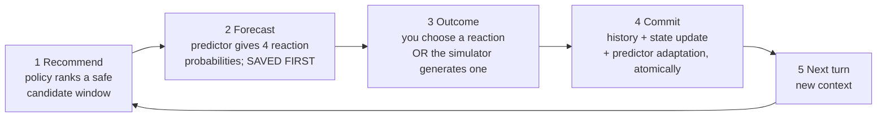
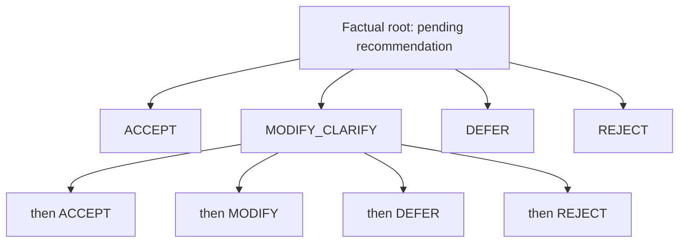

# PCUB Longitudinal Recommendation Lab — User Guide

This guide explains what the application is, what it shows you, and how to read it correctly. It describes the
**bounded system that is actually implemented**. That system is smaller than the original research vision, and most
interpretation mistakes come from confusing the two.

| Companion document | Use it for |
|---|---|
| [`RUNNING_LOCALLY.md`](RUNNING_LOCALLY.md) | Starting the backend and the frontend |
| [`OPERATOR_VERIFICATION_CHECKLIST.md`](OPERATOR_VERIFICATION_CHECKLIST.md) | Step-by-step checks with expected results, and the verification record |
| [`SCIENTIFIC_INTERPRETATION.md`](SCIENTIFIC_INTERPRETATION.md) | What every number means, how it is computed by the backend, and what it does *not* show |

---

## 1. Vision versus what is implemented

The original project imagined a **longitudinal multi-agent conversational recommender**: user, recommender,
behaviour-prediction, memory and evaluation "agents" holding a food conversation over many sessions. This application
implements a **controlled, bounded research testbed** derived from that idea.

| Original vision | What this system actually does |
|---|---|
| Free-form natural-language conversation | **Structured** turns. You choose one of four reaction labels, a continue/disengage flag and optional typed change requests. Free text is stored as a requested-change note and is **never interpreted as a reaction**. |
| Several autonomous LLM agents | Ordinary deterministic or statistical modules. The **only** language-model component is the optional *guarded scorer* policy, which may only score a safe shortlist. Offline, it can answer only 77 exact recorded contexts. |
| A model of the user's psychology | Six **engineered** state variables moved by a fixed rule. They are not measurements of anyone. |
| Validated behaviour prediction | Frozen statistical predictors trained on **synthetic** reference data. No human validation has been done. |
| An oracle for recommendation quality | **No human oracle exists.** The only "oracle" is an exhaustive calculation inside the synthetic simulator. |
| Deployed multi-user service | A single-machine local application with no accounts. See §9. |

---

## 2. One turn, end to end (the factual lifecycle)

Every turn follows the same five steps. The order matters scientifically.

1. **Recommend.** The backend takes a window of candidate recipes, removes those that break your declared hard
   constraints, and the scenario's **policy** ranks the rest. The top recipe is recommended.
2. **Forecast (pre-reaction).** Before any reaction exists, the scenario's **predictor** estimates the probability of
   each of the four reactions. This forecast is stored ("pending") and is never edited afterwards. Storing it is itself
   a committed change, so the session's **revision** goes up by one here.
3. **Outcome (independent of the forecast).**
   - In a **human** session, you submit a structured reaction.
   - In a **synthetic** session, a simulator generates it from private tendencies that the predictor never sees.
   - There is no path from the forecast to the outcome. A forecast is not a prediction that "comes true".
4. **Commit.** One atomic backend operation does all of the following, exactly once:
   - appends the turn to the history;
   - moves the six engineered state variables by a fixed rule that depends only on the reaction;
   - lets an adaptive predictor (class-bias or contextual) learn from the revealed label.

   The session's **revision** number increases by one.
5. **Next turn.** The new history and state change what is recommended and forecast next.

**Concrete example.** These are real values from one run on the offline backend; yours will differ:
- the forecast was ACCEPT 31.0%, MODIFY 39.7%, DEFER 21.3%, REJECT 8.1%;
- the person chose *Modify / clarify* with the change "Please make it quicker to prepare";
- trust moved 0.50→0.51, fatigue 0.50→0.52 and engagement 0.50→0.52, by the fixed MODIFY_CLARIFY rule;
- the revision went 1→2.

The forecast and the outcome disagreeing is normal and is not an error.

---

## 3. The building blocks, in plain language

### Reaction labels (always in this order)

| Label | Mark | Meaning |
|---|---|---|
| ACCEPT | ● green circle, ✓ | Endorses the current recommendation |
| MODIFY_CLARIFY | ◆ orange diamond, ✎ | Asks for an adjustment or explanation without rejecting |
| DEFER | ■ blue square, ⏸ | Postpones the decision |
| REJECT | ▲ red-orange triangle, ✕ | Declines the recommendation |

**Continuation** (CONTINUE / DISENGAGE) is a *separate* flag from the reaction:
- A human DISENGAGE **ends** the session.
- A synthetic DISENGAGE is recorded but does **not** end it. Only the planned horizon does.

### Recommendation policies (all version 1)

| Policy | In plain words |
|---|---|
| **Deterministic** | Scores each safe recipe in the turn's 48-recipe window on health, protein, sodium and matching taste words. Ignores the six state variables. A numeric reference. (It also has a penalty for an exact repeat, which does not occur in a normal session because successive windows never repeat a recipe.) |
| **Constraint-only** | Picks the first safe recipe by id. A deliberate "no intelligence" control. |
| **Feedback-sequence** | Also weighs preparation effort (scaled by fatigue), typed **health** and **effort** requested changes, and similarity to recipes accepted or rejected earlier. Other requested-change dimensions and all free text have no effect on its ranking, and its novelty and repetition terms only act on exact repeats, which do not occur in a normal session. It is the most history-sensitive non-LLM policy. |
| **Guarded LLM scorer** | A language model gives 0–100 scores (not probabilities) to a deterministic safe shortlist of at most 10 recipes. It cannot add recipes, relax constraints or decide outcomes. **Offline, it can answer only requests that exactly match one of the 77 recorded contexts.** New human scenarios generally do not match, and the backend then honestly reports `RECORDED_CONTEXT_UNAVAILABLE` and substitutes nothing. A matching request returns a recorded decision with no live provider call (observed once, for a structured synthetic fixture). On a backend started in optional live mode, a new context makes one real provider request after your explicit permission in the session (see *Live guarded mode* below). |

### Predictor modes (scenario-owned)

| Mode | In plain words |
|---|---|
| **Population** | A frozen statistical model. It never changes during your session. |
| **Class bias** | Starts from the population model and gently shifts toward the reactions this scenario has actually produced. |
| **Contextual** | Starts from the population model and learns a small correction from this scenario's observable features after each reveal. |

Adaptation belongs to **one scenario**. It never crosses to another person or scenario, and it only happens **after**
a reaction is revealed (predict, then reveal, then update).

> **Two predictors, two jobs.** The predictor you choose drives the session's forecasts. **Branch comparisons always
> use the frozen *population* predictor**, even when your session is contextual. Your session's adaptation is never
> carried into the hypothetical branches. The comparison page states this on screen.

### Synthetic simulators (backends)

| Simulator | In plain words |
|---|---|
| **Structured** (`current_structured_simulator@1`) | Combines a profile's private tendencies, how well the recipe fits, recent history and the state into reaction probabilities, then draws one reaction with seeded randomness. |
| **Agenda-derived** (`usersimcrs_agenda_derived@1`) | A rule-based food-domain adaptation inspired by agenda-based user simulation. It is **not** the full official UserSimCRS. It is deterministic, and its probability vector is one-hot. |

In human sessions, the chosen simulator backend only selects the frozen model bundle used for forecasts and branch
estimates. **It never generates your reactions.**

### The six engineered state variables

Trust, motivation, fatigue, satisfaction, engagement and resistance, each between 0 and 1. They all start at 0.5 for a
human session unless you set them. After each reaction they move by a fixed amount:

| Reaction | Trust | Motivation | Fatigue | Satisfaction | Engagement | Resistance |
|---|---:|---:|---:|---:|---:|---:|
| ACCEPT | +0.03 | +0.04 | +0.01 | +0.05 | +0.03 | −0.03 |
| MODIFY_CLARIFY | +0.01 | 0 | +0.02 | 0 | +0.02 | +0.01 |
| DEFER | 0 | −0.01 | +0.04 | −0.01 | −0.02 | +0.01 |
| REJECT | −0.08 | −0.04 | +0.05 | −0.10 | −0.05 | +0.10 |

These are **simulation variables, not measurements** of your trust, fatigue or any psychological state, even when
the reaction came from you.

### The recipe catalog and the safety filter

- **Catalog.** A frozen **10,000-recipe, food-only subset of the HUMMUS dataset**. Each turn the policy ranks a
  **window of about 48 candidates**, not all 10,000.
  - The window is chosen by a stable hash of the profile identity.
  - It advances each turn.
  - Two scenarios with identical settings but different identities therefore see different candidates.
- **No images.** The catalog supplies no image URLs, so none are shown. Some recipes link to their source listing.
- **Hard-constraint filter.** Runs before ranking and is never relaxed. If nothing in the window passes, you get
  `NO_SAFE_RECOMMENDATION`. In this release the interface offers only the controls the filter can actually apply:
  - **vegetarian and vegan**: approximate keyword screening with fixed single-word lists of meat, fish, dairy and egg
    words in the title, ingredients and tags. This is **not guaranteed dietary compliance**: some plural forms are
    missed (in the catalog, 22 recipes pass the vegetarian list while containing only words such as "sausages",
    "crabs" or "prawns");
  - **maximum total recipe time** and **maximum ingredient count**; a recipe whose value is missing is excluded when a
    limit is set.
- **Disabled controls.** Allergy and ingredient-exclusion inputs, and the pescatarian and "other" dietary patterns,
  are disabled in the interface because the backend cannot enforce them (see
  [`SCIENTIFIC_INTERPRETATION.md`](SCIENTIFIC_INTERPRETATION.md) §10). The backend API still accepts them; nothing in
  this application sends them.
- **Limits of the filter.** The catalog's allergen and dietary-label lists are empty in this subset, so the filter
  depends on text matching. It is an imperfect engineering filter, **not an allergy or clinical safety certification**.
- **Free-text request and soft preferences.** The scenario's request text is a soft instruction. Only the guarded LLM
  sees it; no policy treats it as a search or a constraint. Taste preferences add a small ranking bonus when the word
  appears in a recipe's text, and health goals are forecast inputs and guarded-LLM context. Neither is a constraint.
- **Requested changes.** Stored with the reaction and never applied as constraints. With feedback-sequence only the
  *health* and *effort* dimensions change later rankings; the guarded LLM sees the dimensions and text of recent
  requests; deterministic and constraint-only ignore them; the forecast model receives the share of turns with each
  requested dimension as an input. The form states this per policy.
- **Ingredient lines.** Names only: amounts are not part of this catalog subset. Lines that are visibly incomplete in
  the source (for example "of fresh mint" or "cloves") are marked *incomplete in source* and shown unchanged.
- **Health score.** Catalog-derived, preferring Nutri-Score, then FSA, then WHO. It is a compatibility proxy, not a
  nutrition or medical assessment.

### Horizon and segments

A human scenario has 1–4 **segments** × 1–12 **turns per segment** (default 2 × 6). Synthetic scenarios use the
fixture's plan (2 × 6).
- When a segment's last turn is completed, the next turn is turn 1 of the next segment.
- History, state and predictor adaptation carry over unchanged.
- Completing the final planned turn **closes** the session.

---

## 4. Comparing policies on hypothetical futures (the PCUB idea)

From a **pending** recommendation (the "factual root"), the backend asks: *if the person reacted in each possible way,
and then again, what would each of two policies recommend, and how would that go?*

- **Two depths.** 4 first reactions × 4 second reactions gives at most **20 hypothetical nodes**. Each node carries
  *both* policies' next recipes, probabilities and utilities under the same reaction path.
- **Budget (2 / 4 / 8 / 12).** How many of those nodes the **evaluation** may expand.
  - In every run tested so far, the number of expanded nodes equalled the budget, and the tree shows exactly the
    nodes the backend returned.
  - Unexpanded slots are drawn faint and say "no estimate".
  - Before the budgeted evaluation, the backend runs a **preparation pass over the full 20-node forest**, so the total
    work is larger than the budget.
- **Allocators** decide **which hypothetical node to expand next**. They do **not** choose recipes.

  | Allocator | Expands next |
  |---|---|
  | Equal | the first-reaction subtree with the fewest expansions |
  | Greedy | the most probable path |
  | Uncertainty-first | the most uncertain reaction |
  | **PCUB** | a weighted score of probability, uncertainty, policy disagreement and cost, using frozen weights |
- **Limited estimate.** For each policy, the backend averages engineered utility over the **visited** probability mass
  at each depth. This is cheap and approximate: not an unbiased full-tree expectation, and estimates from different
  budgets are not on a common scale. The policy with the larger estimate is "selected".
- **Synthetic oracle (synthetic sessions only).** The backend separately enumerates all 20 nodes using the
  simulator's *private* reaction probabilities and computes each policy's reference value.
  - Its results are **simulator-dependent, not human truth**.
  - It is never an input to the predictor or allocator.
  - Human sessions have no oracle, and the backend rejects a request for one.
- **Regret** = oracle-best value − oracle value of the policy the limited estimate selected.
  - Regret 0 means the limited method picked the policy the simulator prefers, **for this one root**.
  - A single comparison is one case. It says nothing general about PCUB.
  - See [`SCIENTIFIC_INTERPRETATION.md`](SCIENTIFIC_INTERPRETATION.md) for the other metrics.

A comparison is **synchronous** (the page cannot show progress or cancel it). It is stored as an immutable record and
**never changes your session**. The result page shows the session's current revision for comparison.

---

## 5. Six kinds of evidence — never mix them

| Kind | Where | Look | What it is | What it is not |
|---|---|---|---|---|
| Pending forecast | Session, current turn | Dashed card, hatched bars, "Forecast · pending" | Probabilities saved before the reaction | An outcome, or a claim of accuracy |
| Human-submitted outcome | Session evidence | Blue rule, "Human-submitted · factual" | What you chose in this interaction | A human study or validated behaviour |
| Synthetic outcome | Session evidence | Violet rule, "Synthetic · factual in simulation" | What the simulator generated | Human behaviour |
| Hypothetical branch | Comparison page | Blueprint grid, "Hypothetical · counterfactual" | Modeled alternative paths | Anything that happened |
| Synthetic oracle | Comparison page (synthetic only) | Double-ruled panel, "Synthetic reference · not human truth" | Exhaustive reference under the simulator | Ground truth about people or food |
| Frozen R1 results | `/r1` only | Beige archive | Historical aggregates of the earlier R1 experiment | Results of anything you do here |

A synthetic session created from a fixture is a **new** simulation with a new identity and seeds. It is **not** a
replay of the historical R1 run.

---

## 6. What the frozen R1 results say

`/r1` shows the historical R1 experiment exactly as the backend returns it. Values below are as read from the endpoint
on 2026-11-10.

| Question | Finding |
|---|---|
| **RQ1** Does guarded-LLM scoring beat feedback-sequence in expected value? | **No positive gain.** Gain is **−0.0573** (95% interval −0.0710 to −0.0438) on the structured simulator and **−0.1056** (−0.1264 to −0.0857) on the agenda simulator. |
| **RQ2** Do policies react to history? | The guarded scorer's top choice changed in about **42% / 45%** of sibling comparisons, against 7.5% / 6.7% for feedback-sequence. **Higher sensitivity, but not shown to improve utility** (see RQ1). |
| **RQ3** Is PCUB allocation strictly better? | **Strict superiority not established.** On the structured simulator, uncertainty-first had the lowest mean regret (≈0.00056 vs PCUB ≈0.00145). On the agenda simulator PCUB was lowest (≈0.00378), which falls short of the strict claim. |
| **RQ4** Was it operationally reliable and replayable? | **Favorable.** 5,100 reserved and 5,100 completed provider records, 0 unknown, 1 fallback; exact replay with 0 network calls. |
| Formal closure | **Not present** (`formal_closure_present: false`). R1 is not formally closed. |

---

## 7. Pages and how to use them

| Page | What you do there |
|---|---|
| **Overview** `/` | Read the five-step loop (arrow keys move between steps) and the evidence legend. |
| **Live Session** `/lab` | Choose **Human** or **Synthetic**, then a policy, predictor and (for human) a simulator backend, persona, hard constraints, request, horizon and optional initial state. **Your sessions** and **Your comparisons** lists are kept **in this browser only** (the backend cannot list them). Clearing site data or using another browser loses the list, but not the data on the backend; reopen with **Open by id**. |
| **Session** `/lab/sessions/<id>` | Get a recommendation, read the forecast, react (human) or reveal the simulated reaction (synthetic), and watch the timeline and state charts. |
| **Branch explorer** `/lab/sessions/<id>/explore` | Choose two different policies, an allocator, a budget, and (synthetic only) the oracle. |
| **Comparison** `/comparisons/<id>` | Tree, expansion stepper, node details, estimates, oracle, metrics, cost ledger, provenance. |
| **R1 archive** `/r1` | Frozen historical results. |
| **Method** `/method` | Architecture and authority map, limitations, glossary. |
| **System** `/system` | Backend capabilities, the command journal (with **Recover**) and an export of the local index. |

Three things to know about the Session page:
- **State charts** plot only the values **this browser observed** after each turn. Opening the same session in another
  browser shows fewer points, and dashed segments mark gaps.
- **Synthetic sessions** offer "Run 1 turn" and "Run 3 turns with simulator reactions". Each step is its own recorded
  command, and the run stops at the first error.
- There is no "reset". To change constraints, policy, predictor or simulator, **create a new scenario**.

---

## 8. Workflows

Each workflow lists what to do and what to look for. Exact pass criteria are in the
[operator checklist](OPERATOR_VERIFICATION_CHECKLIST.md).

1. **One human turn.** Live Session → Human → an example persona → *Create scenario* → *Get recommendation for turn 1*.
   - Read the recipe and the hard-filter box.
   - Read the dashed forecast and the conformal sets (diagnostic only).
   - Choose a reaction (optionally add a requested change) → *Submit reaction*.
   - Compare **Forecast (made before reveal)** with **Realized**.
2. **Longitudinal continuation.** Play several more turns with different reactions.
   - Watch the timeline and the state charts.
   - With the contextual or class-bias predictor, open the **Adaptation lens**: the returned forecast may differ from
     the frozen population vector after reveals (it is identical for the population predictor).
   - With a short plan (for example 2 segments × 2 turns), turn 3 appears under **Segment 2**.
3. **Ending and honest failures.**
   - Choose Disengage (with confirmation), or *End session*.
   - Create a scenario that cannot be satisfied to see `NO_SAFE_RECOMMENDATION`.
   - Create a guarded-policy human scenario: it usually shows `RECORDED_CONTEXT_UNAVAILABLE`, unless the request
     happens to match one of the 77 recorded contexts.
4. **Human branch comparison.** From a pending turn → *Open the branch explorer* (oracle disabled) → choose policies,
   allocator and budget → *Run branch comparison*. Read the tree, step through the expansion order, select nodes, and
   note that oracle and metrics are **absent, not zero**.
5. **Synthetic session with the oracle.** Live Session → Synthetic → a scenario → *Create* → *Run 3 turns with simulator
   reactions* → *Get recommendation for turn 4* → *Open the branch explorer* (oracle on) → *Run*. Read the synthetic
   reference panel, regret, and whether the limited selection agreed. Back in the session, reveal the reaction and use
   *Run all … remaining turns* to finish the 2 × 6 plan; the closed session shows a trajectory summary.
6. **Frozen R1.** Read `/r1` and confirm none of its numbers appear on session pages.
7. **Persistence and recovery.** Reload a session (same revision and history). On `/system`, inspect the command
   journal.
8. **Mobile and keyboard.** Narrow the window (Turn / History / State tabs appear). Use only the keyboard; the first
   Tab stop is "Skip to content".

---

## 9. Verification status and what it does not mean

- **What was verified.** On source commit `8dee974`, automated tests against the real **offline** backend and a
  hands-on browser walk-through checked that the frontend calls the API correctly and renders its answers faithfully.
  The suite has since grown with the interface; current counts, dates and who ran what are in the
  [operator checklist](OPERATOR_VERIFICATION_CHECKLIST.md#7-verification-record).
- **Functional, not scientific.** Passing tests show the software behaves as specified. They are **not empirical
  validation** of any scientific claim. No human study, no external behavioural validation and no clinical assessment
  has been performed.
- **Local, not production.** Success on one machine does **not** establish:
  - readiness for public hosting;
  - multi-user isolation (there are no accounts, and a session id is an identifier, not a credential);
  - production security, backups, rate limiting, or cancellable asynchronous jobs.

  None of these has been built or reviewed.
- **Offline by default; live guarded mode is optional and bounded.** On a live-capable backend the app:
  - sends a guarded-LLM recommendation only after explicit per-session permission, at most one provider request per click;
  - disables multi-turn runs and guarded branch comparisons;
  - stops live requests on the page after an unknown completion;
  - never retries a request automatically.

  See [`../../LIVE_GUARDED_MODE.md`](../../LIVE_GUARDED_MODE.md).
