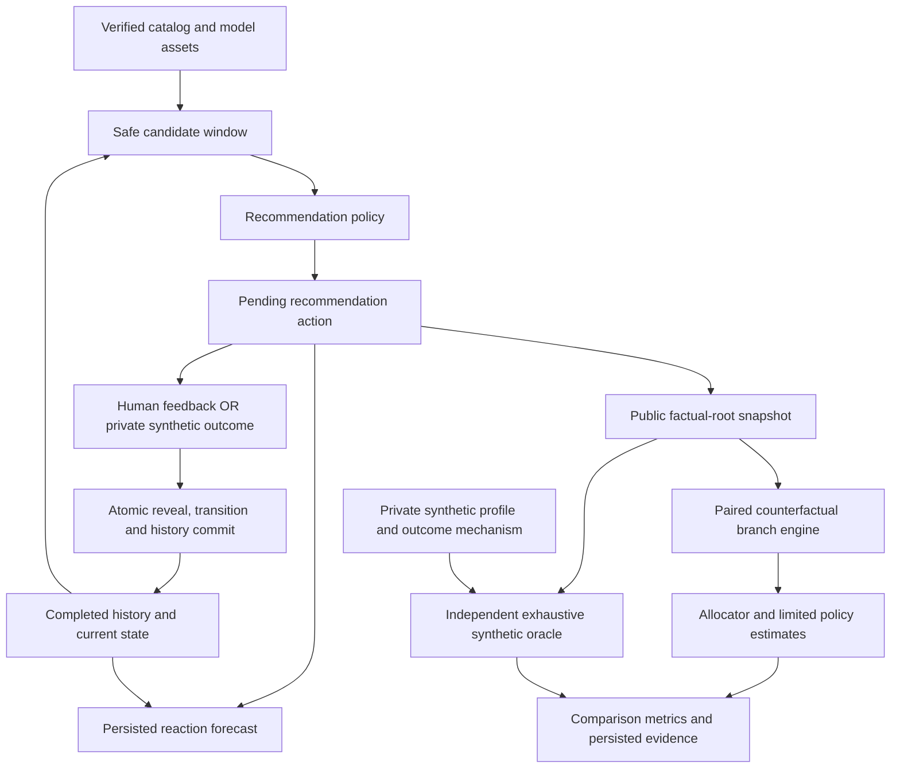
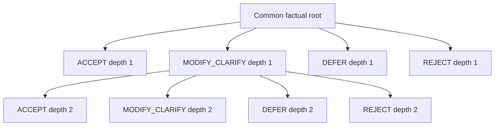
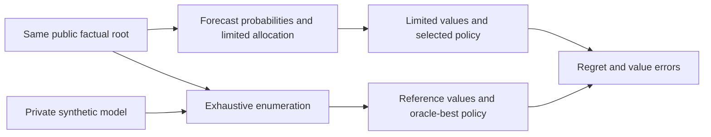
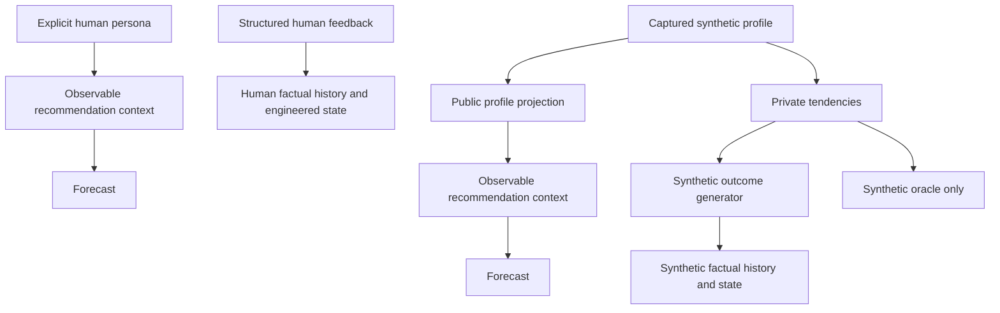
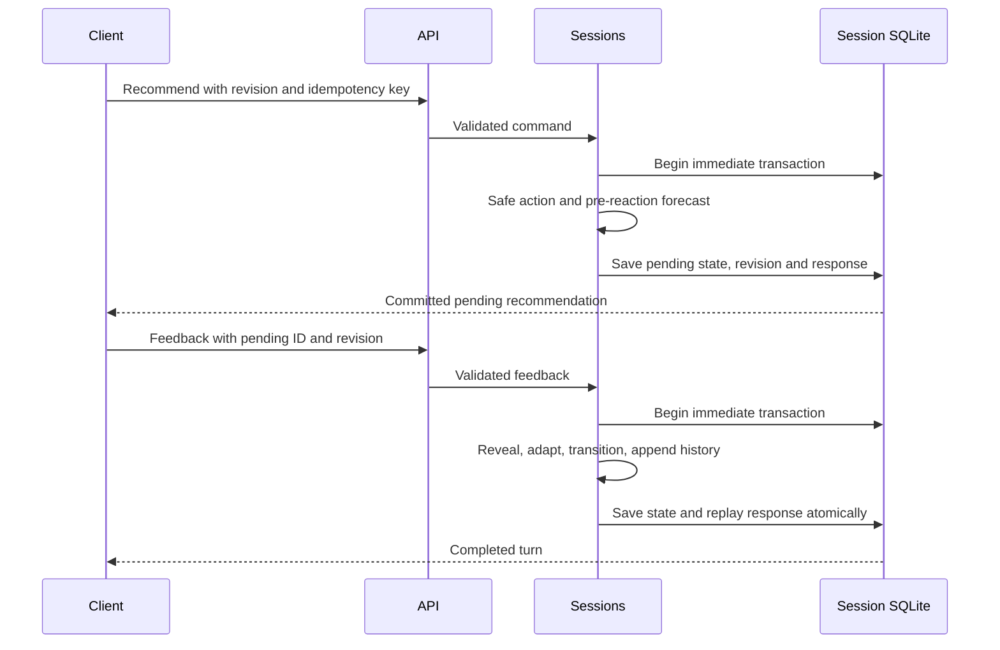
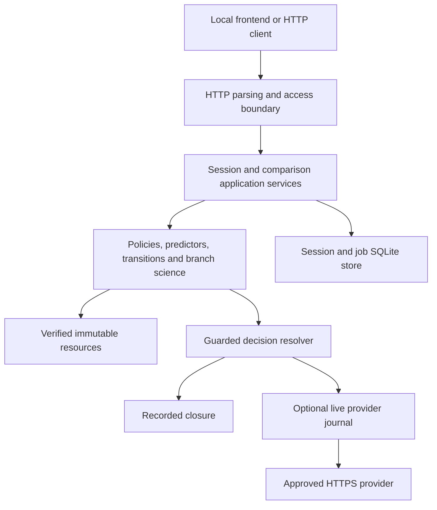

# Master System Report

## Longitudinal Multi-Agent Conversational Recommendation System — Food Domain / PCUB Research Testbed

**System inspected:** `C:\Users\nsreegit22\PCUB_DEMO_BACKEND`  
**Report date:** 10 November 2026  
**Scope:** The reconstructed backend, frozen scientific assets, selected historical evidence, and new local interactive/provider infrastructure.

This report describes executable behavior. Current source takes precedence over older descriptions and the original proposal. Examples identified as captured come from retained fixtures or durable provider records; illustrative examples explain mechanisms without asserting an experiment. Implementation anchors are relative to the reconstructed backend unless another repository is named.

## 1. Executive overview

The system is a controlled research testbed for asking how food recommendation policies behave when recommendations have consequences beyond the current turn. A recommendation elicits a reaction; that reaction becomes history and changes an explicit simulated state; later recommendations and forecasts then operate on a different context. The scientific object is a trajectory of interactions, not merely an item ranking.

A conventional recommender might be judged by whether a user accepts its first suggestion. Here, an immediately attractive suggestion may create repetition, effort burden, or later rejection. The testbed makes these dependencies inspectable. It separates the policy producing a recommendation, the predictor forecasting a reaction, the mechanism supplying an outcome, and the transition updating state. A forecast therefore does not silently become its own ground truth.

The implementation supports four recommendation policies, three factual-session predictor modes, two synthetic outcome backends, conformal prediction-set diagnostics, paired counterfactual branching, four allocation strategies, and a separate exhaustive synthetic oracle. A local HTTP service persists pending recommendations, feedback, predictor state, and comparison jobs. Guarded language-model scoring uses exact recorded decisions or an explicitly enabled live provider with a durable journal.

The working research method, **Personalized Calibrated User Branching (PCUB)**, allocates a limited number of counterfactual evaluations to compare two existing recommendation policies. It does not generate recipes. The implementation is bounded to two reaction depths and engineered synthetic utility. It enables methodological investigation; it does not establish human behavioral validity or universal PCUB superiority.



The oracle path is available only in synthetic evaluation. Its hidden probabilities and preferred policy never feed the online predictor or allocator. Human jobs can produce hypothetical branch estimates but cannot request a human oracle.

**Implementation anchors:** `src/demo_backend/application/backend.py`, `src/demo_backend/application/sessions.py`, `src/demo_backend/application/comparisons.py`, `src/demo_backend/application/policies.py`.

## 2. Research motivation and problem formulation

Static recommendation is often pictured as `user → item → score`. This is useful when observations are independent and the evaluation target is stable. Food decisions complicate both assumptions. A person may like a dish yet lack time to prepare it, accept a nutritionally attractive meal once but dislike repetition, or request clarification without rejecting the recommendation.

The implemented longitudinal formulation is:

`state + completed history + current context → recommendation → reaction and continuation → updated state/history → next context`.

There is no universally correct food recommendation because preferences, constraints, effort, nutrition proxies, and novelty can conflict. A hard allergy exclusion and a soft taste preference are different kinds of information. A policy cannot purchase an allergy violation with a high taste score.

Immediate acceptance is consequently incomplete. An illustrative policy that repeatedly recommends an easy meal could earn early acceptance while becoming less attractive later. Another could incur clarification now and supply a better-fitting subsequent action. Comparison requires considering possible reactions and the recommendations those reactions induce.

The testbed implements this problem with explicit contracts and engineered dynamics. It does not observe all possible futures of a real person. Counterfactual branching asks what the implemented models imply under different reaction paths; the synthetic oracle provides a controlled reference expectation. Reproducibility makes the calculation auditable, without making its simulator assumptions empirically true.

**Implementation anchors:** `src/demo_backend/domain/research.py` (`PredictorInput`, `HistoryEntry`, `ResearchScenario`), `src/demo_backend/branching/engine.py`, `src/demo_backend/evaluation/oracle.py`.

## 3. From research vision to implemented testbed

The original project organized the problem around user, recommendation, behavior prediction, memory, and evaluation agents. In the Day 1 specification, these were deterministic mock components and the runner applied deltas from a behavior-prediction output. That historical architecture is not the authority for the reconstructed backend.

The later PCUB protocol moved toward simulated profiles and controlled trajectories. Its broader vision included independent human judgments of decision appropriateness. Such annotation would evaluate decisions; it would not convert simulated reactions into longitudinal human observations. No new human study is established by this reconstruction.

Here, the recommendation-agent role corresponds to injectable policies. Prediction corresponds to frozen population prediction and optional scenario-specific adaptation. The user role is split between structured human feedback and privileged synthetic outcome generation. Memory is ordered history and persisted state. Evaluation includes prediction metrics, branch estimates, and an exhaustive synthetic reference calculation.

Most scientific operations are deterministic functions of inputs and frozen assets. Structured simulation uses reproducible seeded draws; the agenda-derived mechanism is deterministic. Optional LLM use is restricted to ranking a safe shortlist. Describing this as five autonomous LLM agents would obscure the actual implementation.

Four layers remain distinct: the original multi-agent vision; historical R1 runs and captured results; the reconstructed backend accepted under selected parity tests; and future empirical/deployment work. The service adds transactions and new interactive identities. These additions do not formally close R1 or change historical findings.

**Implementation anchors:** `src/demo_backend/application/reference_trajectory.py`, `src/demo_backend/application/sessions.py`, `src/demo_backend/simulation/structured.py`; historical reference `PCUB V3-R1/AGENTS.md`, `docs/DAY1_BUILD_SPEC.md`, `docs/PCUB_RESEARCH_PROTOCOL_V1.md`.

## 4. Core scientific entities and contracts

Contracts define scientific authority as well as data shape. A predictor should not receive private parameters used to generate its target. History must not originate in the future. A plausible branch action/reaction must not become factual human evidence.

| Entity | Implemented meaning |
|---|---|
| Persona | `UserPersona`: declared dietary pattern, allergies, exclusions, taste/health preferences and recipe limits. |
| Synthetic profile | `SimulatedResearchProfile`: public characteristics plus private tendencies, initial state and outcome references. |
| Dynamic state | Six bounded research scalars with recent preferences, avoided items and notes. |
| Recipe | `RecipeItem`: identity, ingredients, preparation/nutrition metadata and dataset provenance. |
| Recommendation context | Persona, state, candidate recipes, turn index and permitted memory. |
| Action | `RecommenderAction`: selected item, identity, explanation and grounding. |
| Reaction | One of four research labels concerning the current recommendation. |
| Continuation | Separate CONTINUE or DISENGAGE indicator. |
| Requested change | Typed dimensions plus instruction or residual text; dimensions include effort, health, taste, ingredient, cost, novelty, portion and timing. |
| History entry | Position, previous action, revealed reaction/continuation, changes and evidence IDs. |
| Predictor input | Current action, public profile/context, past-only history and legally available features. |
| Forecast | Four reaction probabilities, persisted before feedback in the service. |
| Policy identity | Identifier plus version, rather than display name alone. |
| Scenario/session | A scenario fixes scientific identities/context/horizon; a service session is a durable UUID-owned instance spanning segments. |
| Branch node | Hypothetical path with paired probabilities, downstream actions, utility and costs. |
| Evaluation result | Limited estimates, selected policy, optional oracle values and comparison metrics. |
| Provenance | World, reaction origin, evidence status, execution mode and permitted reference fingerprint. |

Research contracts reject unknown fields, use frozen records, validate bounds, and enforce unique ordered history positions strictly before the current position. A feature available at the current position is designated pre-reaction information. The feature pipeline accepts only `PredictorInput`.

At the captured first turn, an action identifies recipe `72973`. Its predictor input has no current reaction and empty completed history. The workflow test computes the forecast from the regenerated first-turn input and checks it against the captured forecast. In the trajectory, the synthetic mechanism generates MODIFY_CLARIFY with an effort request. That outcome becomes history and changes the state for turn two. Prediction and outcome may disagree without violating any contract.

**Implementation anchors:** `src/demo_backend/domain/platform.py`, `src/demo_backend/domain/research.py`, `src/demo_backend/domain/ontology.py`, `src/demo_backend/domain/service.py`, `src/demo_backend/domain/provenance.py`, `src/demo_backend/ports/recommendation.py`, `src/demo_backend/branching/contracts.py`.

## 5. Dataset and recipe universe

The operational catalog is a frozen **10,000-recipe food-only HUMMUS subset**, loaded from `assets/catalog/hummus_subset_10000.parquet`. It is neither the entire HUMMUS dataset nor the entire historical repository. The loader validates dataset name, size, filter version and ordered recipe-ID fingerprint:

`2f6608400464393cba8240f8bb630a50236fda570edce2131e2f77d1b5c9c32a`.

The captured trajectory also carries a content-level fingerprint:

`recipes-content-sha256:317d7b98e5176b147e7f96418fa9823c021f818d524399a7c98c7ba6601e4472`.

Ordered IDs identify the sequence on which deterministic windows depend; the content fingerprint identifies recipe data used in actions. File hashes separately protect exact bytes. Matching row counts alone establish neither ordering nor content identity.

Metadata includes ingredients, directions, tags, preparation time, servings, ingredient/instruction counts, ratings, nutrition, and compatibility health scores. The adapter prefers nutri-score, then FSA, then WHO when deriving its bounded compatibility score, recording the source. It supplies no image URL and initializes dietary-label/allergen lists empty, so filtering depends substantially on ingredient/title/tag text and structured limits.

Candidate formation normally takes **48 recipes**. A stable hash-derived start and stride depend on profile identity, dataset fingerprint and selection version. The stride is coprime to catalog length. Turn ordinal advances the offset by window size with modular wraparound. Thus a policy ranks within a repeatable window, not necessarily all 10,000 items. Catalog reordering could change decisions even if the unordered recipe set remained the same.

Immutable catalog/model/configuration assets remain separate from runtime SQLite sessions and provider records. Missing scientific assets cause errors, rather than invented fallback data. This differs from the historical Day 1 mock-recipe fallback requirement.

**Implementation anchors:** `src/demo_backend/adapters/catalog.py`, `src/demo_backend/adapters/resources.py`, `src/demo_backend/catalog/windows.py`, `src/demo_backend/catalog/health.py`; `assets/catalog/hummus_subset_10000_manifest.json`, `assets/subset_manifest.json`.

## 6. Safety and constraint filtering

Service and study-branch policies receive a context passed through `safe_context`. The gate rejects duplicate IDs, merges explicit hard exclusions, removes violating recipes, and raises `NoSafeRecommendation` if none remain. HTTP exposes `422 NO_SAFE_RECOMMENDATION`; constraints are not silently relaxed.

Checks cover allergies/exclusions, vegetarian and vegan term lists, maximum time/ingredient/instruction counts, and serving bounds. Missing metadata for a requested structured limit is itself an exclusion reason. The schema recognizes more dietary labels than the filter implements dedicated rules for: pescatarian and other do not receive vegetarian/vegan term-list treatment. This is not a comprehensive dietary ontology.

Illustratively, a declared peanut allergy removes a recipe containing the matching token before ranking. A 20-minute hard limit also removes a recipe with missing preparation time because compliance cannot be verified. If all candidates fail, the service requests clarification or a new scenario.

Retained low-level deterministic and constraint-only functions contain historical least-bad fallback logic. The reconstructed application prevents that path by applying the hard gate first. Calling those functions directly without the gate would not inherit the service guarantee.

This is an engineering filter over imperfect metadata. Token matching, incomplete terminology and missing allergen annotations limit coverage. It is not clinical food-safety certification. Soft scoring cannot override an exclusion, but the exclusion rules themselves remain bounded by their implementation.

**Implementation anchors:** `src/demo_backend/safety/gate.py`, `src/demo_backend/safety/attributes.py`, `src/demo_backend/recommendation/deterministic.py` (`_constraint_violations`), `src/demo_backend/application/sessions.py`, `src/demo_backend/branching/simulator.py`, `src/demo_backend/api/server.py`.

## 7. Recommendation policies

All four public policies have version `1`. They share the upstream candidate window and hard filter, making differences interpretable as ranking differences within a common eligible context.

| Policy identifier | Mechanism and role | Provider use |
|---|---|---|
| `deterministic_recipe_recommendation` | Health, protein, sodium, taste and repetition score; numeric reference. | None |
| `constraint_only_baseline` | Lexicographically first compatible recipe ID; infrastructure control. | None |
| `feedback_sequence_recipe_recommendation` | Health/taste/effort, signed decayed interaction similarity and repetition penalty. | None |
| `guarded_llm_score_vector` | Positional integer scores over a deterministic safe shortlist, deterministic ties and guarded fallback. | Recorded or optional live |

The deterministic source score is

\[
S(r)=100h(r)+0.25\min(p(r),60)-0.02\max(n(r)-800,0)+5m(r)-20I_{recent}(r).
\]

Here `h` is normalized health (missing becomes zero), `p` is protein grams per serving (missing becomes zero), `n` is sodium milligrams per serving (no penalty if missing), and `m` counts matching taste preferences. The final term penalizes a previously exposed item. Ties use recipe ID ascending. State is passed to the function, but this score does not use the six state scalars.

The feedback policy sums

\[
(1+0.35q_h)h+0.6t-(0.25+1.5f+0.45q_e)e
+0.8R-(0.3+0.6v+0.2q_n)\min(3,c).
\]

`q_h`, `q_e`, and `q_n` are health, effort and novelty request counts capped at three; `t` is matched taste fraction; `f` is fatigue; `e=min(time/60,1)`, with missing time assigned one; `v` is observable novelty preference, default 0.5; `c` is recent exposure count. Signed reinforcement is

\[
R=\sum_i s_i\,0.8^{N-1-i}\operatorname{sim}(r_i,r),
\]

where acceptance contributes `+1`, rejection `−1`, and other reactions zero. Similarity is one for identical IDs, otherwise Jaccard similarity of alphabetic ingredient tokens longer than two characters. Newer events receive greater weight. Requested-change dimensions come from observable history when available.

For two illustrative safe dishes, deterministic ranking may favor the higher-health dish even if it takes longer. Feedback ranking can favor the easier dish after an effort request or increased fatigue. The constraint-only control may choose either because its ID sorts first. Guarded scoring can consider bounded textual context but cannot add an item outside its shortlist.

Policies produce actions; PCUB evaluates possible futures of two policies. The selected action in a comparison is its selected policy's prepared root action. Creating a comparison job does not change the factual session's configured policy or commit the comparison's action.

**Implementation anchors:** `src/demo_backend/application/policies.py`, `src/demo_backend/recommendation/deterministic.py`, `src/demo_backend/recommendation/baselines.py`, `src/demo_backend/recommendation/feedback.py`, `src/demo_backend/recommendation/guarded.py`, `src/demo_backend/branching/engine.py`.

## 8. Guarded LLM recommendation

The guarded path gives the model a narrow scoring task. Deterministic code first filters candidates. If more than ten remain, shortlist construction takes unique IDs from feedback top five and deterministic top five, then fills from their rankings to ten. Positions are finally ordered by recipe ID. The feedback policy's full safe ranking is retained as fallback.

The prompt contains declared preferences/constraints, six state values, up to six completed history entries, bounded exposure/acceptance/rejection lists, bounded preference feedback, the request, and limited recipe metadata. It validates chronology, strips control characters and truncates text. A firewall rejects forbidden concepts such as private tendencies, oracle information and future outcomes. Prompt instructions treat user and recipe text as untrusted data. These constrain the interface; they do not prove arbitrary natural-language content harmless.

The response schema requires one strict integer from 0 to 100 per candidate position, supported reason codes, and a bounded tradeoff summary. Scores are preferences, not probabilities, and need not sum to 100. The application validates JSON, vector length and canonical mapping, sorts descending score, and breaks ties by recipe ID. The model cannot supply authoritative outcomes, alter state, relax safety constraints, or invoke tools.

A decision fingerprint hashes canonical contract/prompt identity, decoding settings, observable context, position mapping and fallback-ranking hash. Recorded replay requires an exact fingerprint match. The bounded closure contains **77 recorded decisions**; a similar context is insufficient. Missing closure raises an availability error instead of fabricating an answer.

A completed invalid response can yield the saved feedback-policy fallback. Integrity failures, missing recorded decisions, exhausted budgets and unknown live completion are distinct and must not be disguised as ordinary fallback. Live transport makes one attempt, prohibits redirects, and has no retry. A durable raw response can be parsed again locally without another provider request.

Preserved Phase-10 evidence contains one successful Lehmus decision selecting **recipe `58944` — Kfc Gravy**, with `fallback=false`, `attempt_count=1`, and origin `live_guarded`. Reported usage is **2,118 input + 1,216 output = 3,334 total tokens**. The fingerprint is:

`f77ad401b89d02eb6c52fe461b588f5d07809e46897c98a028b71203863c3429`.

The provider label is `lehmus` and returned model label `cm-llm`. This demonstrates guarded execution and accounting, not improved recommendation utility. An earlier reservation, `58042e08261e754db20d0d0c72b380c9ea1c0ca7da0a983361aa81c5a2b71a6e`, has neither durable response nor parsed record. It remains unknown completion. Preserving it avoids treating an absent local response as proof that the provider did no work.

**Implementation anchors:** `src/demo_backend/recommendation/shortlist.py`, `prompt.py`, `guard_contracts.py`, `guarded.py`, `json_extract.py`; `src/demo_backend/adapters/recorded.py`, `src/demo_backend/adapters/live.py`; `release_evidence/phase10_provider_summary.txt`; read-only `runtime/provider.sqlite3` records.

## 9. User reactions and longitudinal outcomes

The reaction order is **ACCEPT, MODIFY_CLARIFY, DEFER, REJECT**. Acceptance endorses the current recommendation; modification/clarification requests adjustment or explanation; deferral postpones a decision; rejection declines it. Continuation separately records CONTINUE or DISENGAGE. Acceptance does not logically prove continued engagement, and clarification does not imply disengagement.

A **predicted reaction** is a forecast from observable information. A **synthetic authoritative reaction** is the realized simulator label for its declared world. A **human-submitted reaction** is structured service feedback. “Authoritative” means authoritative within the simulation, not verified human behavior. Predictions never automatically become factual outcomes.

The two backends are `current_structured_simulator@1` and `usersimcrs_agenda_derived@1`. The structured backend combines private tendencies, recipe fit, prior history and state into reaction logits. For example, its ACCEPT logit before archetype adjustment is

\[
0.05+1.55F+0.5M+0.3T-1.75KS-0.85E-0.55B-0.45R-0.45G-0.45X,
\]

where `F` is overall fit, `M` motivation, `T` trust, `K` constraint conflict, `S` private constraint sensitivity, `E` effort mismatch, `B` budget mismatch, `R` repetition, `G` fatigue and `X` resistance. Other reactions use different fixed coefficients. Archetype adjustments are added; logits are rounded to eight decimals before temperature-0.92 softmax. A stable seed from scenario/profile/position/version identities supplies reaction and continuation draws. The private context deliberately has no forecast field.

Overall fit weights health/taste by private priorities and inverse effort/budget mismatch by 0.65/0.45. Budget mismatch is an ingredient-count proxy, not observed prices. Continuation probability is a sigmoid of engagement, trust, fatigue, resistance, progress and reaction adjustment. Requested changes on MODIFY_CLARIFY reflect detected mismatch dimensions.

The agenda-derived backend is a versioned food-domain adaptation, not the full official UserSimCRS simulator. It rejects constraint conflicts, requests novelty after accepted-item repetition for novelty-sensitive profiles, and otherwise thresholds a private preference expression over health, taste and effort. Its authoritative reaction has one-hot probabilities. Its external-action mapping refuses definite labels for ambiguous intents alone; bare LIKE or YES is insufficient without supported commitment context.

Synthetic trajectories retain continuation evidence but the full-horizon loop does not terminate on synthetic DISENGAGE. The service closes early on human DISENGAGE, not synthetic DISENGAGE. Branch transitions assume CONTINUE. Continuation therefore is not a fully modeled stopping process in current policy value.

**Implementation anchors:** `src/demo_backend/domain/ontology.py`, `src/demo_backend/simulation/structured.py`, `src/demo_backend/simulation/agenda.py`, `src/demo_backend/simulation/numeric.py`, `src/demo_backend/application/reference_trajectory.py`, `src/demo_backend/application/sessions.py`.

## 10. Dynamic longitudinal state

Trust, motivation, fatigue, satisfaction, engagement and resistance lie in `[0,1]`. Their names support interpretable simulation rules. They are **engineering constructs, not validated measurements of human psychology**, even when the same transition follows human feedback.

Each reaction adds a fixed delta, clamps to `[0,1]`, and rounds to four decimals:

\[
s'_j=\operatorname{round}_4(\min(1,\max(0,s_j+\Delta_j(r)))).
\]

| Reaction | Trust | Motivation | Fatigue | Satisfaction | Engagement | Resistance |
|---|---:|---:|---:|---:|---:|---:|
| ACCEPT | +0.03 | +0.04 | +0.01 | +0.05 | +0.03 | −0.03 |
| MODIFY_CLARIFY | +0.01 | 0 | +0.02 | 0 | +0.02 | +0.01 |
| DEFER | 0 | −0.01 | +0.04 | −0.01 | −0.02 | +0.01 |
| REJECT | −0.08 | −0.04 | +0.05 | −0.10 | −0.05 | +0.10 |

Requested instructions append to `recent_preferences`, retaining twelve. `avoided_recently` and `notes` are retained fields; rejection does not automatically populate avoided items. Accepted/rejected recipe histories are maintained separately. Numeric deltas are reaction-dependent, not direct recipe-dependent psychological inferences.

The captured Phase-11 profile `pcub-profile-0002-23d45e44` first receives **72973 — Vegetarian White Beans With Black Kale & Savory Cabbage**. Its reaction is **MODIFY_CLARIFY**, continuation CONTINUE, with “Please adjust: effort.”

| Variable | Before | After |
|---|---:|---:|
| Trust | 0.6637 | 0.6737 |
| Motivation | 0.7103 | 0.7103 |
| Fatigue | 0.1625 | 0.1825 |
| Satisfaction | 0.5876 | 0.5876 |
| Engagement | 0.5832 | 0.6032 |
| Resistance | 0.2571 | 0.2671 |

No clipping occurs. The instruction is retained; avoided items and notes stay empty. The next recommendation is **312054 — Blueberry Cream Cheese Danish Oatmeal**, with exactly one completed history entry visible.

The first recipe has 360-minute preparation metadata, the second seven minutes. This illustrates changed context but does not prove the deterministic policy obeyed the effort request. Its score does not use requested effort or fatigue directly; candidate windows advance and repetition history changes. The feedback policy explicitly uses effort requests/fatigue. This distinction prevents an attractive causal story from exceeding the mechanism.

**Implementation anchors:** `src/demo_backend/simulation/transition.py`, `src/demo_backend/domain/research.py`, `src/demo_backend/recommendation/deterministic.py`, `src/demo_backend/recommendation/feedback.py`; `assets/golden/fixtures/reference/H20_completion.json`.

## 11. Behavior prediction

A predictor estimates the next-reaction distribution conditional on the current action and pre-reaction information. It neither estimates a hidden correct recommendation nor supplies authoritative feedback.

The frozen feature pipeline standardizes continuous features using saved training means/scales, encodes categories with group-specific unknown indicators, and includes position, history depth, prior reaction/request rates, repetition, item text matches and six state scalars. The catalog extension adds effort, health and fatigue-times-effort. Resource loading checks feature names, class order and coefficient shapes.

Population prediction is multinomial logistic regression:

\[
z=xW+b,\qquad p_k=\frac{\exp(z_k-\max_jz_j)}{\sum_j\exp(z_j-\max_lz_l)}.
\]

The runtime loads coefficients rather than fitting them. Factual-session modes are:

| Mode | Adaptation |
|---|---|
| `population` | Frozen probabilities; no per-session update. |
| `class_bias` | Revealed class counts adjust population probabilities relative to a training prior. |
| `contextual` | Online softmax correction on selected observable features after reveal. |

For class bias, prior `π`, concentration `α` and revealed counts `n` yield posterior `(απ+n)/(α+Σn)`. Prediction adds `log(posterior)−log(π)` to log population probabilities and applies softmax, with numerical clipping at `1e−15`. The structured bundle uses concentration 100, restraining early changes.

The contextual adapter forms `x̃=[1, clip(selected features,−3,3)]` and predicts `softmax(log(clip(p_population, 1e−15, 1)) + x̃A)`. After reveal,

\[
A\leftarrow A-\frac{\eta}{\sqrt{1+u}}
\left[\frac{\widetilde{x}(p-y)^\top}{1+\widetilde{x}^\top\widetilde{x}}+\lambda A\right].
\]

`u` counts prior updates and `y` is the one-hot revealed label. The adapter stores a pending prediction and rejects another before reveal, repeated reveal, skipped history depth, or changed profile/scenario ownership. This is **prequential** operation: predict without the answer, then reveal and update for the next turn. Structured settings use learning rate 0.01 and L2 coefficient 0.1.

Private tendencies, outcome probabilities and current/future labels are excluded. Otherwise accuracy could be manufactured by reading the answer. Branch comparisons use the frozen **population** `BranchPredictor`, regardless of factual personalization mode; they do not adapt the factual contextual adapter down each branch.

Names such as `FrozenCalibratedBranchPredictor` and `calibrated_step_probability` are retained identifiers. Actual reconstructed branch prediction directly calls the frozen model's `predict_proba`. These names do not establish separately applied temperature scaling or human calibration.

**Implementation anchors:** `src/demo_backend/prediction/base_features.py`, `features.py`, `population.py`, `contextual.py`; `src/demo_backend/application/prediction.py`, `src/demo_backend/branching/predictor.py`; `assets/models/*/settings.json`.

## 12. Conformal uncertainty diagnostics

A probability vector gives relative forecast weights, but its most-probable class hides ambiguity. Conformal diagnostics construct a set of plausible labels using a threshold derived from saved calibration scores. Wider sets communicate less decisive discrimination; they are not outcome generators.

Retained methods are `APS_V1`, `APS`, `RAPS` and `SAPS`. Let `p_(k)` be descending probabilities, ties resolved by ontology order, and `u∈[0,1]` a reproducible randomization value:

\[
\begin{aligned}
\mathrm{APS\_V1}_k&=\sum_{i\leq k}p_{(i)},\\
\mathrm{APS}_k&=\sum_{i\leq k}p_{(i)}-(1-u)p_{(k)},\\
\mathrm{RAPS}_k&=\mathrm{APS}_k+\lambda\max(k-k_{reg},0),\\
\mathrm{SAPS}_1&=up_{(1)},\quad
\mathrm{SAPS}_{k>1}=p_{(1)}+\lambda(k-2+u).
\end{aligned}
\]

For nominal coverage `c` and `n` calibration scores, modern methods use one-based sorted rank `ceil((n+1)c)`, returning an infinite threshold if rank exceeds `n`. APS_V1 clips rank to `n`. Modern sets contain scores at most the threshold and can be empty. APS_V1 instead uses the smallest probability prefix reaching the threshold, including the crossing class. These boundary differences are tested.

Illustratively, `[0.4,0.3,0.2,0.1]` with APS_V1 threshold 0.65 yields `{ACCEPT, MODIFY_CLARIFY}`, whose mass is 0.7. The same threshold need not yield that set under randomized APS or RAPS.

Service diagnostics use **population probabilities**, even when the main forecast is personalized. The service derives `u` from observation identity and uses saved backend thresholds. Nominal coverage refers to frozen synthetic-reference calibration, not a per-person guarantee or guaranteed coverage on human feedback or shifted contexts.

Conformal output does not prune branches, alter frontier membership or directly supply PCUB uncertainty. PCUB uses a probability-based entropy contribution. Conformal calibration is diagnostic and synthetic, with no guaranteed human coverage claim.

**Implementation anchors:** `src/demo_backend/uncertainty/aps.py`, `src/demo_backend/uncertainty/conformal.py`, `src/demo_backend/application/prediction.py`; `assets/models/*/thresholds.json`; `tests/test_science.py`.

## 13. Why counterfactual branching exists

A pending recommendation leaves the future unresolved. Acceptance, clarification, deferral and rejection create different histories and states. A history-sensitive policy can then select different recipes. Policy value therefore depends on a tree of subsequent interactions rather than one immediate score.

A fair comparison starts both policies at the same **factual root**: person/public characteristics, completed past, state, request, catalog and position. Each recomputes its own root action. They need not select the factual pending recipe or the same recipe as one another. Comparing separately realized histories would confound policy behavior with different starting conditions.

The engine pairs corresponding reaction labels across policies. ACCEPT under one policy may have a different probability and downstream action from ACCEPT under another. Pairing labels permits shared allocation without assuming equal outcomes. Counterfactual histories remain hypothetical; a REJECT-then-MODIFY_CLARIFY path is not something the user actually did. Its separate comparison job does not advance factual state.

**Implementation anchors:** `src/demo_backend/application/roots.py`, `src/demo_backend/domain/roots.py`, `src/demo_backend/branching/engine.py` (`prepare_root`), `src/demo_backend/application/comparisons.py`.

## 14. Branch engine

A prepared root contains two snapshots, two policy actions and two population distributions. Four initial frontier candidates represent first reactions. Expanding a candidate applies that reaction separately to each policy snapshot, appends hypothetical history, updates state, obtains the next recommendation and evaluates state/action utility.

A depth-one expansion also forecasts reactions to those next actions and adds four depth-two candidates. Depth two applies a second reaction and recommends at the following position. Thus two reaction depths require horizon for a third action position; the service rejects insufficient horizon.



Every node contains paired policy evidence, not a shared recipe. Other first reactions can produce the same four second labels. The complete tree has `4+16=20` paired reaction nodes. Engine budgets range from 1 to 20; the API exposes 2, 4, 8 and 12.

For each policy, path probability multiplies that policy's step probabilities. Displayed node probabilities average the two policies, but estimates preserve each policy's weights. The run starts with two recommendation and two predictor calls. Every expansion adds two recommendations; depth-one expansions also add two predictions. These logical counters are not provider-call counts because recommendations may be deterministic or replayed.

Snapshot updates create new state/history objects. The engine never advances factual database state. Hypothetical MODIFY_CLARIFY contains residual clarification text without inventing specific change dimensions; all branches use CONTINUE. This simplified branch outcome differs from the richer changes the private simulator can generate.

**Implementation anchors:** `src/demo_backend/branching/engine.py` (`BranchSimulator`, `BranchEngine`), `src/demo_backend/branching/simulator.py`, `src/demo_backend/branching/contracts.py`, `src/demo_backend/application/comparisons.py`.

## 15. Allocators

An allocator chooses **which frontier node receives the next expansion**, not which recipe to recommend. Equal allocation favors the first-reaction subtree with the fewest expansions; greedy favors probability; uncertainty-first favors uncertainty; PCUB combines probability, uncertainty, disagreement and cost.

| API name | Exact identifier |
|---|---|
| `equal` | `equal_round_robin` |
| `greedy` | `greedy_highest_probability` |
| `uncertainty` | `uncertainty_first` |
| `pcub` | `pcub_probability_uncertainty_disagreement` |

For step probabilities `p₀,p₁` and cumulative path probabilities `q₀,q₁`,

\[
P=(q_0+q_1)/2,\qquad U=(g(p_0)+g(p_1))/2,
\]

with `g(0)=0` and otherwise

\[
g(p)=\min\left(1,\frac{-p\log(p)/\log(4)}{1/(e\log(4))}\right).
\]

This is a normalized single-class entropy contribution, not whole-distribution entropy. It is maximal near `p=1/e`.

Action disagreement is zero for equal recipe IDs. Different recipes yield `0.5+0.5×JaccardDistance` over their ingredient-string sets, capped at one. If an item is absent, the code compares selected-item objects for inequality. Unlike feedback similarity, this distance does not tokenize ingredients. The disagreement component multiplies action distance by reaction sensitivity: ACCEPT 0.2, MODIFY_CLARIFY 0.6, DEFER 0.4, REJECT 1.0. Cost is currently one per candidate.

The implemented score is

\[
\operatorname{PCUB}(v)=w_PP(v)+w_UU(v)+w_DD(v)-w_CC(v).
\]

Weights are finite and nonnegative with at least one positive benefit weight. Largest score wins. Ties use depth, first-reaction ontology index, current-reaction index, then candidate ID. Other allocators use this same tie order after their primary criterion.

Frozen DEVELOPMENT selections are structured `(P,U,D,C)=(0.5,0.5,0,0)` and agenda-derived `(0.7,0.2,0.1,0)`. The structured captured example therefore has **zero disagreement weight**, despite the general identifier. Constant cost also cannot distinguish candidates within a step.

**Implementation anchors:** `src/demo_backend/branching/allocators.py`, `src/demo_backend/branching/engine.py` (`_candidates`, `_action_disagreement`, `_entropy_contribution`); `assets/weights/*/selection.json`.

## 16. PCUB in the research design

Exhaustive evaluation grows rapidly with depth and policy count. PCUB asks whether a selected subset can identify the better policy with less evaluation work. Probability favors consequential paths, uncertainty favors ambiguous reactions, and disagreement can favor paths where policies differ. Their benefit remains empirical, not guaranteed by the score.

For each policy and depth, the limited estimator averages utility over visited probability mass and sums available depth averages:

\[
\widehat V_\pi=\sum_{d\in\{1,2\}:M_{\pi d}>0}
\frac{\sum_{v\in\mathcal V_d}q_\pi(v)u_\pi(v)}{M_{\pi d}},
\qquad M_{\pi d}=\sum_{v\in\mathcal V_d}q_\pi(v).
\]

Unvisited mass is neither explicitly assigned zero nor filled from oracle values. Each visited depth is renormalized. A run visiting only one depth has a different scale from a two-depth estimate; sparse coverage can bias comparisons. The larger estimate wins, ties following canonical policy order.

The captured S1T4 comparison follows three completed observations. It compares `feedback_sequence_recipe_recommendation` and `guarded_llm_score_vector` using `pcub_probability_uncertainty_disagreement`, budget **8**. It expands three depth-one and five depth-two nodes.

| Policy | Limited estimate | Exhaustive synthetic value |
|---|---:|---:|
| Feedback sequence | 1.441080117521505 | 1.433230984785729 |
| Guarded score vector | 1.4426226885099314 | 1.4196901644920954 |

PCUB selects **guarded**, while the exhaustive oracle prefers **feedback sequence**. Regret is **0.013540820293633571**. MODIFY_CLARIFY is expanded first, then ACCEPT; REJECT is not an expanded first-reaction branch. This adverse example is evidence of approximation error, not a success demonstration.

The application performs a full observable 20-node preparation pass before limited evaluation to establish guarded decision closure. An eight-expansion comparison is consequently a bounded **evaluation** experiment, not a claim that the whole request did only eight nodes of work or saved every corresponding live call. Preparation costs must remain visible.

**Implementation anchors:** `src/demo_backend/branching/engine.py` (`_estimate_values`, `run`), `src/demo_backend/application/comparisons.py`; `assets/golden/fixtures/reference/H20_completion.json`, `branches_current_structured_simulator_1.json`.

## 17. Independent exhaustive synthetic oracle

An oracle is a deliberately privileged evaluation instrument: it computes the reference answer under the synthetic model so the limited evaluator can be assessed. It is not available to the online policy. Its private profile/scenario arguments are supplied separately from the public root.

The oracle enumerates all four first reactions and all four second reactions for each policy. It obtains probabilities from the private synthetic outcome mechanism rather than the predictor. Its expectation is

\[
V_\pi=\sum_{r_1}p^*_\pi(r_1)
\left[u_\pi(r_1)+\sum_{r_2}p^*_\pi(r_2\mid r_1)u_\pi(r_1,r_2)\right].
\]

`p*` denotes authoritative synthetic-model probabilities, not measured human frequencies. Utility at each depth is computed after applying its reaction and obtaining the subsequent recommendation. Oracle enumeration uses its own loop and does not reuse the allocator's visited subset or estimated probabilities. It shares policy, transition and utility primitives: independence does not mean an unrelated behavioral model.



For S1T4 the oracle values are feedback **1.433230984785729** and guarded **1.4196901644920954**. Regret evaluates the policy selected by the limited method:

\[
\mathrm{regret}=\max_\pi V_\pi-V_{\widehat\pi}
=1.433230984785729-1.4196901644920954
=0.013540820293633571.
\]

Even exhaustive traversal with predicted probabilities need not equal this oracle because probability-model error remains. “Oracle” means exact enumeration of this bounded synthetic objective, not universal knowledge of good food choices. Human sessions cannot request it.

**Implementation anchors:** `src/demo_backend/evaluation/oracle.py`, `src/demo_backend/evaluation/comparison.py`, `src/demo_backend/application/comparisons.py`; `tests/test_science.py` (`test_branches_and_oracle`, independent captured-contribution arithmetic).

## 18. Utility and evaluation

The primary state component averages four favorable state values and inverses of resistance/fatigue:

\[
U_s=(satisfaction+engagement+trust+motivation+1-resistance+1-fatigue)/6.
\]

The action component combines normalized recipe health `h` with constraint fit:

\[
F_c=1-\min(k/2,1),\quad U_a=0.5h+0.5F_c,\quad u=0.7U_s+0.3U_a.
\]

`k` is the number of known constraint issues in the selected action; missing health uses 0.5 here. This missing-value rule differs from deterministic ranking's zero fallback. With upstream hard filtering, `k` normally equals zero. The utility remains an engineered objective, not measured human welfare or clinical benefit.

Illustratively, `U_s=0.6`, health `0.8` and zero violations give `U_a=0.9` and `u=0.69`. The two-depth oracle sums two expected utilities without discounting; values can therefore exceed one. An optional alternative state-weight dataclass exists for diagnostics, but the service's study simulator uses the primary equal-weight state component.

For two compared policies, MAE is the mean absolute difference between limited and oracle values; RMSE is the square root of mean squared differences. Rank agreement compares the signs of the two policy-value differences. Best-policy correctness uses regret at most `1e−12`. Expansion evidence records actual count, order, depth counts, and number of first-reaction subtrees visited. Branch recipe disagreement is the mean indicator that paired downstream recipe IDs differ; it is distinct from ingredient-distance disagreement used by PCUB.

The adverse captured example has MAE **0.015390828376806054**, RMSE **0.01713927569257896**, rank agreement **0.0**, and branch recipe disagreement **1.0**. Different recipes do not imply the limited selection was correct.

Retained predictive metrics include negative log likelihood `−log(p_truth)` with clipping at `1e−15`, and multiclass Brier score `Σ_k(p_k−1[k=truth])²`. These evaluate forecasts, whereas regret evaluates policy selection. The service does not present every retained metric as a new interactive experiment.

**Implementation anchors:** `src/demo_backend/branching/engine.py` (`utility`, `AlternativeStateUtility`), `src/demo_backend/evaluation/comparison.py`, `src/demo_backend/evaluation/prediction_metrics.py`, `src/demo_backend/evaluation/prequential.py`.

## 19. Longitudinal memory and history

Longitudinality is a concrete dependency: each new recommendation receives completed actions/reactions and the state resulting from them. The session reconstructs recent recipe IDs, accepted/rejected IDs and requested-change feedback from ordered history. Predictors use prior rates, last reaction and repetition. Feedback ranking uses signed similarity and requested dimensions. Guarded prompts retain a bounded recent window rather than unlimited conversation text.


A pending forecast is not completed history. This prevents training on an unobserved answer and avoids counting the same reaction twice. Numeric state advances only on feedback, not on GET requests or repeated reads of a recommendation.

The outer service session can contain several segments. Position is computed from completed-history length and turns per segment; crossing a segment boundary does not reset state/history or predictor adaptation. Human creation permits one to four segments and one to twelve turns per segment, defaulting to two by six. Synthetic creation uses the fixture plan. Horizon completion closes the session. A new scenario creates fresh predictor ownership and adaptation state.

The legacy `avoided_recently` field is not a substitute for rejected-item history, and recent preference text is not a hidden psychological measurement. These distinctions make the longitudinal dependency inspectable instead of relying on vague claims that the system remembers a user.

**Implementation anchors:** `src/demo_backend/application/sessions.py`, `src/demo_backend/application/reference_trajectory.py`, `src/demo_backend/recommendation/feedback.py`, `src/demo_backend/recommendation/prompt.py`, `src/demo_backend/prediction/base_features.py`, `src/demo_backend/simulation/transition.py`.

## 20. Human interaction versus synthetic simulation

| Question | Human interaction | Synthetic simulation |
|---|---|---|
| Who supplies identity/constraints? | Explicit submitted persona; private baseline traits forbidden. | Curated profile projected to a public persona with derived constraints where applicable. |
| Who determines reaction? | Structured human submission. | Selected private outcome mechanism. |
| Private synthetic profile? | None. | Retained internally. |
| State interpretation | Engineered response to feedback, not measured psychology. | Engineered simulated state. |
| Oracle? | Forbidden. | Optional bounded synthetic oracle. |
| Repeatability | Depends on submitted responses. | Fixed identities/seeds support controlled repeatability. |
| Evidence claim | New human-submitted interaction, not a study by itself. | New simulation, not automatically historical R1 replay. |



No arrow runs from either forecast to the authoritative outcome. Human state transitions still use the engineered delta table. A frontend must not rename resulting trust or fatigue as measured mental states.

The synthetic projection sets a 30-minute preparation limit when private effort tolerance is below 0.38 and a 12-ingredient limit when private budget sensitivity exceeds 0.72. Recommendation policies receive the resulting limits through the public persona. A new synthetic service session copies the fixture's profile, request and horizon but assigns a new scenario UUID and seed namespace. Therefore it is not exact historical replay, even if the initial recommendation matches. Recorded guarded closure may also be unavailable for its new context. Human feedback is structured; the backend does not infer ACCEPT or REJECT from unrestricted prose.

**Implementation anchors:** `src/demo_backend/domain/service.py` (`CreateSession`, `HumanOutcome`), `src/demo_backend/application/sessions.py`, `src/demo_backend/application/roots.py`, `src/demo_backend/simulation/profile_adapter.py` (`_persona`), `src/demo_backend/domain/provenance.py`.

## 21. Transactional session system

Scientific correctness depends on one realized reaction producing one transition and, when an adaptive predictor is active, one adaptation update. A duplicated web request must not create duplicated behavioral evidence.

A session starts at revision zero. Recommendation checks the supplied expected revision and open status, constructs the action and forecast, persists pending adapter state, and increments revision. If a pending recommendation already exists at the valid revision, it is returned without a second prediction. Feedback must identify that pending recommendation and the current revision.



SQLite `BEGIN IMMEDIATE` protects the read/check/write operation. Canonical payload hashes and `(scope,key)` idempotency rows store committed responses. Repeating the same key and payload returns the original response, including after restart or response loss. Reusing the key with another payload yields `IDEMPOTENCY_CONFLICT`. A different key carrying a stale revision yields `STALE_REVISION` rather than repeating the transition.

Exactly-once here means one committed feedback effect under these transactional/idempotency conditions, not exactly-once delivery over an unreliable network. State, history, predictor reveal/update and saved response commit together or roll back together. The provider journal is separate because a remote call cannot be rolled back with a session transaction.

Cancel and close are terminal operations in this minimal service. They move pending evidence to cancellation history, clear pending contextual state and do not reveal a reaction or change behavioral state. Human DISENGAGE and horizon exhaustion close sessions; segment rollover otherwise preserves history. Contextual state is owned by profile/scenario, preventing adaptation leakage between people or scenarios.

The Phase-11 HTTP walkthrough follows create → recommend → compare → feedback → repeat identical feedback → GET. During the manual reconstruction run, the operator stopped and restarted the server and retrieved the same persisted human session and branch-comparison job. The session was at revision 2 with one completed history entry. The job was pinned to factual revision 1, had status `complete`, used budget 8, recorded 8 actual expansions and selected `deterministic_recipe_recommendation`. The regenerated `release_evidence/phase11_restart_persistence.txt` records the persisted IDs and values, which match the SQLite records on read-only inspection.

**Implementation anchors:** `src/demo_backend/adapters/sqlite.py`, `src/demo_backend/application/sessions.py`, `src/demo_backend/domain/service.py`, `tests/test_service.py`; archived manual `docs/API_CONTRACT.md`; `release_evidence/phase11_restart_persistence.txt`.

## 22. Provider journal and live-call accounting

Unknown completion is easiest understood as a lost receipt: the provider may have processed a request even though the application lacks a durable response. Automatically sending it again could create a second charged decision while pretending only one occurred.

The journal reserves the decision fingerprint and canonical request **before transport**. A Windows OS writer lock serializes live use. The transport stores its complete raw response before scoring is finalized; the parsed decision is subsequently bound to request and response hashes. The journal therefore distinguishes reserved-without-response, response-durable-without-record, and completed-record states.

A response-durable/record-missing request can be parsed locally again. A reservation without a response raises `UnknownCompletion`, a non-fallback budget-boundary exception. It blocks automatic retry. Completed records are reused without another transport; recorded historical decisions are checked before live journal lookup. Integrity checks bind the record to its original request and durable response.

The preserved two-reservation state is instructive:

| Reservation | Durable response | Parsed record | Interpretation |
|---|---|---|---|
| `58042e08…b71a6e` | No | No | Unknown completion; do not retry or erase. |
| `f77ad401…c3429` | Yes | Yes | Successful Lehmus guarded result; 3,334 reported tokens. |

There is one successful accounted response and one unresolved reservation, not evidence of exactly one total provider attempt. Unknown token use remains unknown, not zero. The live-call ceiling counts all historical reservations in that journal, including uncertain ones. A new journal must not be used to evade that ceiling; enforcement is journal-local and relies on retaining the operational journal, not on a provider-wide global quota mechanism.

Branch jobs first prepare the full observable forest and collect a sealed set of decision keys. This preparation may use live calls. Evaluation then uses a fresh read-only resolver and cannot create new decisions; its live-call/token cost is zero after successful closure. Cost responses separate preparation, evaluation and combined totals. Failure during preparation can leave durable provider reservations even though the session/job transaction rolls back. A successful zero-call evaluation does not erase those costs.

The provider journal is not a scientific outcome store: it proves what recommendation scoring was requested/received, not how a human reacted. Cached live decisions retain live provenance even when their incremental cost is zero.

**Implementation anchors:** `src/demo_backend/adapters/live.py` (`Journal`, `Transport`, `LockedGuardedPolicy`), `src/demo_backend/recommendation/guarded.py`, `src/demo_backend/application/comparisons.py`, `src/demo_backend/application/sessions.py`, `tests/test_live_journal.py`.

## 23. API and service architecture

The HTTP layer parses and validates requests, applies origin/optional token checks, calls application operations, and returns structured JSON. It does not calculate policy utility or interpret free-form feedback. Application services orchestrate scientific components and persistence.



| Endpoint | Purpose |
|---|---|
| GET `/v1/capabilities` | Discover configured modes, exact policies/backends, predictors, budgets and limitations. |
| GET `/v1/recipes/{id}` | Return catalog recipe metadata. |
| POST `/v1/sessions` | Create human or synthetic session. |
| GET `/v1/sessions/{id}` | Read persisted session without advancing it. |
| POST `/v1/sessions/{id}/recommendations` | Create or return pending recommendation. |
| POST `/v1/sessions/{id}/feedback` | Commit structured feedback, cancel, or close. |
| POST `/v1/branch-comparisons` | Run and persist a synchronous paired comparison. |
| GET `/v1/branch-comparisons/{id}` | Retrieve saved comparison without recomputation. |
| GET `/v1/reference-results/r1` | Return labeled historical aggregate assets. |

POST requests require JSON and an idempotency key of 1–128 characters. State-dependent commands carry expected revision. Request schemas reject extra fields; POST bodies are limited to 65,536 bytes and transfer encoding is rejected. Successful operations return HTTP 200, including creation. Errors distinguish stale revisions, unavailable recorded contexts, unknown provider completion, no-safe-recommendation, invalid requests and asset integrity failures.

The server binds to `127.0.0.1`, uses the standard-library threaded HTTP server, and optionally checks one configured frontend origin and shared bearer token. It has no user accounts or per-user resource authorization. A session UUID is an identifier, not a security credential. This is suitable for a bounded local frontend handoff, not automatically public multi-user hosting.

Comparison jobs are synchronous and hold a session-store write transaction during preparation/evaluation. There is no asynchronous worker queue, resumable incomplete-job handle or general cancellable job endpoint. Public or unattended live use needs separately tested infrastructure. The archived API contract is useful documentation, but current routing and schemas remain authoritative, including added provider-cost fields.

**Implementation anchors:** `src/demo_backend/api/server.py`, `src/demo_backend/domain/service.py`, `src/demo_backend/application/backend.py`, `src/demo_backend/application/sessions.py`, `src/demo_backend/application/comparisons.py`; archived reconstruction manual `docs/API_CONTRACT.md`, `docs/10.md`.

## 24. Provenance and evidence classes

Provenance prevents a result from acquiring scientific authority merely through presentation. A simulated “factual” outcome is factual within its simulated world; it is not a human observation. A live-generated recommendation does not make the subsequent outcome live human evidence.

The implemented dimensions are world kind, reaction origin, evidence status, recommendation execution mode and reference fingerprint:

| Evidence | World/status/origin | Meaning |
|---|---|---|
| Historical replay | `reference_replay`, factual, `recorded_synthetic` | Captured synthetic reference evidence with upstream fingerprint. |
| New synthetic outcome | `synthetic_simulation`, factual, `synthetic_generated` | Realized in a new simulation; no historical run fingerprint. |
| Human feedback | `human_interaction`, factual, `human_submission` | Submitted structured response; not a human study by itself. |
| Branch evidence | Human or synthetic world, counterfactual, `hypothetical` | Modeled alternative path, never a committed response. |
| Pending forecast | Pending, origin null | No revealed current reaction. |
| Recorded guarded action | Execution `recorded_guarded` | Exact cached scoring decision; does not change the outcome's world. |
| Live guarded action | Execution `live_guarded` | Live-journal lineage, including later cached reuse. |

Reference replay requires a nonempty reference fingerprint and forbids live-guarded execution. Interactive evidence must not carry an upstream reference-run fingerprint. The validator allows factual origins only when they match the world, pending origin only when null, and counterfactual origin only when hypothetical.

The historical-results endpoint explicitly sets `formal_closure_present=false` and labels its tables as historical R1 aggregates rather than interactive-demo results. It states that RQ1 positive gain and RQ3 strict superiority were not established. This label must survive any future visualization. Neither a new human interaction nor a successful provider request changes that historical claim boundary.

**Implementation anchors:** `src/demo_backend/domain/provenance.py`, `src/demo_backend/application/backend.py` (`reference_results`), `src/demo_backend/application/sessions.py` (`public`), `src/demo_backend/application/comparisons.py`; `assets/golden/fixtures/new_contracts/A5.json`.

## 25. Reproducibility architecture

The reconstruction preserves a bounded operational package rather than copying every historical artifact. Its subset manifest lists **320 files**, including catalog, whole model packages, allocator selections, configuration, recorded closure, golden fixtures, capture provenance and historical tables. Resource loading verifies manifest identity and each listed SHA-256 before accepting the assets. Model-package manifests additionally protect each frozen artifact, while ordered feature-name and matrix-shape checks prevent a numerically plausible but misaligned model load.

The sealed capture fingerprint is:

`368727191a5801c928aef6cff992ca16b9237c3ee920e9308c3f3987e039f0b6`.

The current operational subset fingerprint is:

`9ec70fca613378c7b3c2faf579a3dd69a813439f1714d0fa244e45b3701cf093`.

These are different identities. The former identifies reference capture provenance; the latter identifies the selected copied assets. The implementation ledger records source/configuration/test hashes. The asset-migration ledger maps copied assets; the archived scientific migration ledger maps retained historical symbols and their provenance. Golden fixtures preserve expected intermediate values as well as final outputs, making parity more diagnostic than checking only a final recommendation.

Deterministic identities include ontology order, recipe order, canonical JSON, policy/version references, stable seeds, decision hashes and allocator tie rules. Frozen means these source/model/configuration/assets are retained under those identities for selected parity claims. It does not mean interactive UUIDs, timestamps or live model output are universally deterministic. New interactive scenarios intentionally acquire new identities; exact recorded replay has a narrower promise.

The release directory contains source-verification output, the full 18-test result, Python/package versions, copied ledgers/manifests, offline capabilities, capture fingerprint and provider summary. The report's fresh source-verifier run also passed. These support the backend's accepted/frozen status under selected reconstruction checks, not formal closure of historical R1 or external behavioral validity.

Runtime databases and provider journals remain outside immutable assets. Their contents evolve through new interactions and must not be rewritten to reproduce a favorable result. Scientific fitting/training is not part of report generation or an API request.

**Implementation anchors:** `src/demo_backend/adapters/resources.py`, `src/demo_backend/adapters/recorded.py`, `src/demo_backend/domain/canonical.py`, `src/demo_backend/domain/seeds.py`; `tools/verify_source.py`, `implementation_ledger.json`, `asset_migration.json`, `assets/subset_manifest.json`, `release_evidence/`.

## 26. Verification and validation status

The retained full suite reports **18 tests passed in 138.815 seconds**, ending in `OK`. Its PowerShell wrapper includes stderr-formatting text around unittest output; that wrapper is not evidence of a failed test when the retained suite result is explicitly successful. This report inspected the tests and saved output but did not rerun the full suite or create new runtime sessions. A fresh execution of the read-only source verifier reported “Documented file hashes and Python syntax verified.”

| Evidence/check | What it establishes | What it does not establish |
|---|---|---|
| Source hashes and syntax | Current documented source matches its ledger and parses; no historical `crs_sim` import dependency. | Behavioral correctness of every possible input. |
| Safety/ranking golden cases | Selected filter reasons, ordering, components and ties match captures. | Comprehensive clinical safety. |
| Outcome/features/personalization cases | Selected synthetic outcomes, transitions, feature vectors, logits and updates match. | Human predictive validity. |
| Conformal cases | Retained scoring, quantiles, sets and boundaries match. | Human coverage guarantees. |
| Branch/oracle cases | Prepared roots, expansions, estimates, exhaustive values and metrics match fixtures. | Universal allocator superiority. |
| Longitudinal/workflow cases | Captured trajectories and the H20/S1T4 projection reproduce in the retained suite. | That new UUID-based sessions are exact R1 replay. |
| Service tests | HTTP paths, idempotency, rollback, duplicate concurrency, store reopening, ownership and branch isolation. | Production-scale availability or multi-user security. |
| Journal tests | Durable-response recovery without second transport and unknown-completion non-retry using fake transport. | Provider availability under every failure. |
| Live Lehmus record | One successful real guarded scoring record, recipe and token accounting. | Positive utility gain or resolution of the earlier unknown reservation. |

The manual Phase-11 run verified retrieval of the same session and job after a planned server stop and restart. The regenerated release summary records the persisted IDs, session revision 2 and one completed history entry, and job status `complete`, budget 8, 8 actual expansions and selected policy `deterministic_recipe_recommendation`. Read-only SQLite inspection confirmed all of those fields. The retained service tests independently cover reopening the store, replaying committed idempotent responses and handling concurrent duplicate calls.

The archive's `VERIFICATION_REPORT.md` describes pre-delivery manual validation on 8 November, explicitly before construction. It must not be substituted for the later backend release output. Conversely, the later selected-test acceptance does not retroactively constitute formal historical R1 closure. No independent new human validation or literature-based novelty assessment was performed for this document.

**Implementation anchors:** `tests/test_science.py`, `tests/test_service.py`, `tests/test_live_journal.py`, `tools/verify_source.py`; `release_evidence/complete_test_output.txt`, `source_verification.txt`, `phase10_provider_summary.txt`, `phase11_restart_persistence.txt`.

## 27. Complete end-to-end trajectory

The captured Phase-11 example connects the mechanisms without blending historical and interactive envelopes.

First, resource loading verifies the subset and model hashes, restores the ordered HUMMUS catalog and frozen prediction settings, and loads the captured profile/scenario. The profile is `pcub-profile-0002-23d45e44`, the backend is structured, and ordinary recommendation uses the deterministic policy. The profile adapter can derive public preparation-time and ingredient-count limits from private tendencies. The recommender receives the projected persona, and the predictor receives observable inputs. The outcome generator and synthetic oracle receive the private profile.

At S1T1, stable candidate-window selection supplies the position-specific recipe pool. The hard gate removes incompatible candidates. Deterministic ranking selects **72973 — Vegetarian White Beans With Black Kale & Savory Cabbage**, with captured displayed score **106.03**. The action contains its dataset fingerprint and policy grounding. Empty history and initial state form legal predictor input.

The captured population forecast in ontology order is:

```text
ACCEPT           0.39943799499491195
MODIFY_CLARIFY   0.3726012613958405
DEFER            0.15602287566414794
REJECT           0.0719378679450995
```

These are predictions. The private outcome generator has a different probability vector:

```text
ACCEPT           0.15024614471340267
MODIFY_CLARIFY   0.5757041453541815
DEFER            0.18168268075792895
REJECT           0.09236702917448694
```

Its captured reaction draw is **0.4722921406462448**, producing MODIFY_CLARIFY; continuation probability **0.7848437255111015** and draw **0.3695066488414386** produce CONTINUE. The outcome requests effort adjustment. These private probabilities/draws explain the synthetic realization but are not predictor inputs.

The fixed transition increases trust to **0.6737**, fatigue to **0.1825**, engagement to **0.6032**, and resistance to **0.2671**, retaining motivation **0.7103** and satisfaction **0.5876**. The instruction enters recent preferences. The completed action/reaction becomes one history entry. The next window and permitted context yield **312054 — Blueberry Cream Cheese Danish Oatmeal**, captured displayed score **106.58**. This establishes the exact data dependency without claiming the deterministic score directly interpreted the effort request.

Conformal diagnostics can accompany a service forecast using the frozen population model and saved thresholds. No particular set is asserted here as an H20 captured value: its exact randomized set depends on the applicable observation identity and calibration settings. The numerical illustration in Section 12 is explicitly illustrative.

Later, at **S1T4**, after three completed observations, the common root is projected for feedback-sequence versus guarded comparison. Each policy prepares its own action. PCUB with structured weights and budget eight expands MODIFY_CLARIFY, ACCEPT, MODIFY_CLARIFY→MODIFY_CLARIFY, DEFER, ACCEPT→MODIFY_CLARIFY, DEFER→MODIFY_CLARIFY, ACCEPT→ACCEPT, and MODIFY_CLARIFY→DEFER, in that order.

Visited-mass estimates favor guarded **1.4426226885099314** over feedback **1.441080117521505**. Independent exhaustive synthetic evaluation instead favors feedback **1.433230984785729** over guarded **1.4196901644920954**. Selection regret is **0.013540820293633571**. The comparison does not overwrite any of the three completed observations or commit a fourth reaction.

The reference trajectory generator constructs legal inputs and outcomes but does not itself call the predictor inline. The captured workflow test independently evaluates the frozen predictor. The new service counterpart differs operationally: it commits pending action/forecast at one revision, then atomically reveals feedback and advances history at the next. It also adds idempotency responses, UUID ownership, provider costs and provenance. These new envelopes are not claimed to be historical R1 records.

In human mode the same public action/forecast machinery operates, but structured human feedback replaces the private synthetic generator and oracle requests are rejected. In live guarded mode a recommendation may require a durable provider reservation; it still does not grant the LLM authority over reaction or state. This is the complete machine: observable decisions and forecasts, separately authorized outcomes, controlled state/history evolution, hypothetical policy comparison, and durable evidence with explicit lineage.

**Implementation anchors:** `assets/golden/fixtures/reference/H20_completion.json`, `turns_current_structured_simulator@1.json`, `branches_current_structured_simulator_1.json`; `src/demo_backend/application/reference_trajectory.py`, `src/demo_backend/application/sessions.py`, `src/demo_backend/application/comparisons.py`; `tests/test_science.py` (`test_workflow_projection`).

## 28. Scientific contributions and research level

The testbed's sophistication lies in the combination of controlled longitudinal dynamics, explicit information boundaries, probabilistic forecasting, bounded counterfactual allocation and reproducible evaluation. Each element makes a different failure observable. Forecast/outcome separation prevents self-confirming labels. Common-root comparisons reduce starting-condition confounding. Independent exhaustive calculation exposes allocation and prediction error rather than merely displaying plausible branches.

The system enables investigation of whether adaptation improves synthetic next-reaction prediction; how uncertainty diagnostics behave under retained reference conditions; whether allocation weights improve limited policy selection; and how rankings differ between deterministic, feedback-sensitive and guarded policies. It supports adverse examples, not just demonstrations selected for attractive outcomes.

Engineering choices contribute to research integrity. Idempotency prevents duplicated behavioral labels. Revision checks protect the factual root. Hashes make silent asset replacement detectable. Provenance prevents simulated or counterfactual outputs from being presented as human observations. Provider reservations make failed or uncertain calls visible instead of allowing unreported retries to select a favorable response.

Guarded LLM integration is especially controlled: a flexible scorer can participate without owning outcome generation, state dynamics, utility or oracle probabilities. This allows a future provider/model study to vary recommendation scoring while preserving the surrounding evaluation machinery.

These are substantive research-enabling properties. They are not a publication-level novelty claim, which would require literature analysis and a more complete empirical argument. Selected parity and engineering acceptance establish a usable testbed, not that its research hypotheses have been confirmed.

**Implementation anchors:** `src/demo_backend/domain/research.py`, `src/demo_backend/application/roots.py`, `src/demo_backend/branching/engine.py`, `src/demo_backend/evaluation/oracle.py`, `src/demo_backend/adapters/sqlite.py`, `src/demo_backend/adapters/live.py`; golden tests and release evidence.

## 29. Limitations and non-claims

The six state dimensions and transition deltas are synthetic engineering choices. Their names do not establish psychological measurement validity. Applying them after human feedback does not change that status. Calibration uses frozen synthetic reference evidence, and there is no guaranteed human conformal coverage.

The food catalog is a bounded subset with imperfect metadata and limited dietary matching. Candidate windows constrain which recipes can be selected. Nutrition compatibility scores and ingredient-count cost proxies are not comprehensive health, affordability or clinical assessments. The four-reaction ontology and typed changes simplify real conversation; unrestricted natural-language understanding is not implemented at the feedback boundary.

Population coefficients, feature transforms, thresholds and allocator selections are frozen. Class-bias and contextual adapters update scenario-owned state, not the population model. Branch prediction remains population-based. Counterfactual continuation is fixed to CONTINUE, clarification branches omit specific change dimensions, and evaluation has only two reaction depths. Limited visited-mass normalization can introduce bias and budget-dependent scale effects.

The oracle is exhaustive only for the implemented bounded synthetic objective and shared transition/recommendation semantics. Its utility is engineered, not human welfare. Error against it can reflect both imperfect prediction and limited allocation. The captured adverse case directly rules out presenting every PCUB selection as oracle-correct. No universal PCUB superiority or positive guarded-LLM utility gain is established.

Recorded guarded availability is restricted to exact closure. Live use depends on provider access and schema compatibility; temperature zero does not guarantee provider reproducibility. One preserved reservation has unknown completion. Journal-local accounting does not provide a provider-wide global enforcement mechanism, and full observable preparation means the online service's total work is larger than the nominal limited evaluation budget.

There is no new human study, no formal historical R1 closure, and no evidence that reconstruction changed historical conclusions. A successful human-submission service test is not a longitudinal participant experiment. Current source verification and selected tests establish reproducibility within their scope, not external validity.

The loopback server is not production public hosting. Shared optional authorization is not per-user access control. Synchronous jobs hold write transactions and have no durable incomplete-job handle or asynchronous cancellation protocol. The Phase-11 walkthrough validates retrieval after a planned local restart. Production crash recovery falls outside that check. These limits should remain visible in any frontend or supervisor demonstration.

**Implementation anchors:** `src/demo_backend/application/backend.py`, `src/demo_backend/application/comparisons.py`, `src/demo_backend/api/server.py`, `src/demo_backend/branching/engine.py`, `src/demo_backend/simulation/transition.py`; archived manual `docs/10.md`; `release_evidence/`.

## 30. Current status and logical next steps

The backend is reconstructed and frozen under the selected parity/acceptance evidence, with a verified source ledger, retained 18-test success, operational local API contracts, and a documented live guarded success. It is ready for **local frontend handoff within these boundaries**. The Phase-11 restart record supports local persistence, and the historical-results endpoint reports `formal_closure_present=false`.

Frontend work should expose the factual trajectory, pending forecast, hypothetical branch tree, visited probability mass, oracle comparison where allowed, provider accounting and provenance as distinct concepts. It should submit structured feedback and revision/idempotency values rather than recomputing state, utility or allocation. Historical R1 views should remain separately labeled.

Hosted-demo hardening would require access control, request limits, production serving, backup/recovery procedures, asynchronous job ownership and cancellation, and deployment-specific provider controls. These are future engineering tasks, not capabilities already supplied by changing a bind address.

Larger empirical evaluation should compare policies and allocators over prespecified roots, budgets and outcome models, preserving negative cases and separating preparation cost from evaluation cost. Human validation should separately test behavioral forecasts, interpretations of state, and decision appropriateness; simulated oracle performance cannot substitute for it.

Alternative datasets/domains would require new catalog identities, constraints, features and outcome assumptions. Improved behavioral models should be validated independently and versioned rather than silently replacing frozen assets. Deeper branching, explicit continuation/stopping models and richer hypothetical requested changes would change the objective and cost structure, so they require new parity and evaluation contracts.

Provider/model studies could vary guarded scoring under a prespecified first-response accounting protocol. Methodological extensions could examine allocation under model misspecification, visited-mass estimation bias, uncertainty-weight design and the value of disagreement across backends. These are logical investigations enabled by the testbed, not results established here.

**Implementation anchors:** `src/demo_backend/application/backend.py` (`capabilities`), `src/demo_backend/domain/service.py`, `src/demo_backend/api/server.py`; archived manual `docs/10.md`, `docs/11.md`; `release_evidence/`.

## 31. Glossary

| Term | Definition in this report |
|---|---|
| CRS | Conversational recommendation system: recommendation contextualized by an interaction history. |
| PCUB | Personalized Calibrated User Branching; the working research method, implemented here as bounded paired branch evaluation/allocation around existing policies. |
| UBPA | User Behavior Prediction Agent, a historical conceptual component; current forecasting is implemented by explicit predictor classes. |
| Reaction | ACCEPT, MODIFY_CLARIFY, DEFER or REJECT concerning a recommendation. |
| Continuation | CONTINUE or DISENGAGE, distinct from reaction. |
| Policy | Versioned mechanism selecting/ranking eligible recipes. |
| Predictor | Mechanism estimating reaction probabilities from permitted pre-reaction inputs. |
| Prequential | Predict before reveal; update only after the realized label is available. |
| Branch | Hypothetical reaction path with its own state/history and subsequent actions. |
| Allocator | Rule selecting the next frontier node to expand. |
| Factual root | Shared pre-reaction state and completed history from which policies are compared. |
| Counterfactual | Modeled alternative trajectory, not a realized user observation. |
| Oracle | Independent exhaustive evaluation instrument using privileged synthetic probabilities. |
| Regret | Oracle-best value minus oracle value of the policy selected by the limited evaluator. |
| Utility | Explicit engineered state/action score used for synthetic policy comparison. |
| Conformal set | Reaction-label set obtained using a frozen calibration threshold and specified score rule. |
| APS | Adaptive Prediction Sets; cumulative-probability scoring family, with retained legacy and randomized variants. |
| RAPS / SAPS | Retained regularized APS / sorted adaptive prediction-set methods; exact formulas are specified in Section 12. |
| Provenance | Explicit lineage and authority labels identifying the world, origin, status and execution mode of evidence. |
| Decision fingerprint | SHA-256 identity of a canonical guarded scoring request and its contractual context. |
| Recorded closure | Exact set of guarded decision contexts available for replay without fresh provider calls. |
| Unknown completion | Durable request reservation without a durable response; remote completion cannot safely be assumed absent. |
| Idempotency | Repeated identical keyed command returns its committed response without repeating its effect. |
| Revision | Monotonic session state version checked by state-dependent commands. |
| Immutable asset | Hash-identified reference data/model/configuration intended to remain unchanged during operation. |
| Frozen | Retained source/settings/assets under specified identities and selected parity evidence, not a guarantee of external validity. |

## Source and Evidence Note

The authoritative implementation inspected was `C:\Users\nsreegit22\PCUB_DEMO_BACKEND\src\demo_backend`, followed by current tests, release evidence, implementation ledger and operational subset manifest. Mathematical formulas above were read from current source. H20, turn and branch fixtures supplied captured numerical values. Provider details were read from selected non-secret fields in the existing journal, not inferred from the manual or regenerated through live calls.

The directory `C:\Users\nsreegit22\PCUB_DEMO_MANUAL` was empty at inspection. Supporting documentation was instead located in `C:\Users\nsreegit22\PCUB_DEMO_RECONSTRUCTION_ARCHIVE_2026-11-08\01a1b527-ea9e-7743-a687-7214d9e79947\reconstruction_manual`, including the numbered phases and API contract. Its pre-construction verification statements were distinguished from later backend release evidence. Historical motivation/terminology came from the protected reference repository's Day 1 specification and PCUB protocol; proposal aspirations were not treated as current capabilities.

The sealed capture at `C:\Users\nsreegit22\PCUB_R1_GOLDEN_CAPTURE_2026-11-07` was treated as protected reference evidence through the copied, hash-identified capture manifests and fixtures. Neither it nor `C:\Users\nsreegit22\PCUB V3-R1` was modified. Runtime database inspection used read-only connections. The final audit read the session database in immutable mode after confirming its WAL was empty. No provider request, scientific fit, training run, new session, or full test rerun was performed to write this report.

The report was the sole file edited in the final audit. The audit checked source hashes, report structure and before/after file hashes. The regenerated Phase-11 release summary records the session and comparison job retrieved during the planned local restart check. The provider reservation described in Section 22 remains unresolved.
